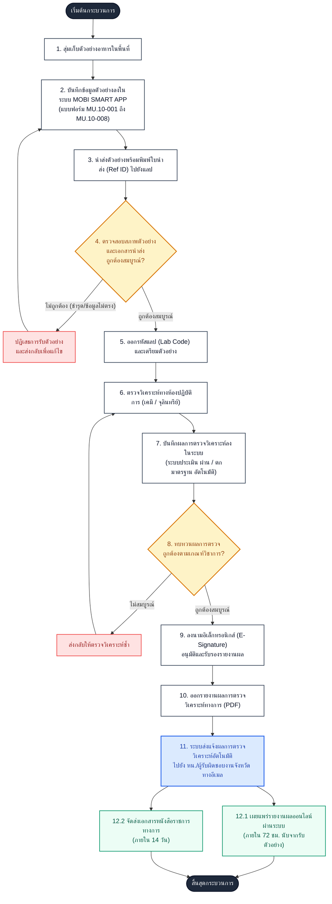

# คู่มือขั้นตอนการปฏิบัติงานมาตรฐาน (Standard Operating Procedure: SOP)
## ระบบตรวจวิเคราะห์และเฝ้าระวังความปลอดภัยด้านอาหาร (MOBI SMART APP)
**หน่วยเคลื่อนที่เพื่อความปลอดภัยด้านอาหาร เขตสุขภาพที่ 10 (เวอร์ชัน 2027)**
**รหัสเอกสาร:** SOP-MOBI-2027-001  
**วันที่ประกาศใช้:** ปีงบประมาณ พ.ศ. 2570  
**สถานะ:** ฉบับสมบูรณ์ ถูกต้องตามระเบียบวิธีและกระบวนการจริง (Production & Standard Verified)

---

## 1. วัตถุประสงค์ (Objectives)
1. **ด้านมาตรฐานกระบวนการปฏิบัติงานและความถูกต้องทางห้องปฏิบัติการ (Standardization & Operational Integrity):**  
   เพื่อกำหนดขั้นตอน มาตรฐาน และแนวทางการปฏิบัติงานที่เป็นหนึ่งเดียวกันทั่วทั้งเขตสุขภาพที่ 10 ในการใช้งานระบบ **MOBI SMART APP** ตั้งแต่การลงทะเบียนยืนยันตัวตน การสุ่มเก็บตัวอย่างอาหารและผลิตภัณฑ์สุขภาพตามแบบฟอร์มมาตรฐาน การตรวจรับ การตรวจวิเคราะห์ทางห้องปฏิบัติการตามหลัก GLP การรับรองผลด้วยลายมือชื่ออิเล็กทรอนิกส์ (E-Signature) ตลอดจนการออกรายงานผลทางการ เพื่อให้ผู้ปฏิบัติงานทุกระดับ (ผู้เก็บตัวอย่าง เจ้าหน้าที่แลป ผู้รับรองผล และผู้ดูแลระบบ) ปฏิบัติงานได้อย่างถูกต้อง รวดเร็ว โปร่งใส และตรวจสอบย้อนกลับได้ทุกขั้นตอน
2. **ด้านการเฝ้าระวังเชิงรุก การบริหารเชิงยุทธศาสตร์ และการคุ้มครองประชาชน (Surveillance, Governance & Health Protection):**  
   เพื่อขับเคลื่อนระบบเฝ้าระวังความปลอดภัยด้านอาหารเชิงรุก เชื่อมโยงข้อมูลระหว่างพื้นที่และห้องปฏิบัติการในการติดตามแก้ไขปัญหาตัวอย่างตกเกณฑ์มาตรฐานอย่างทันท่วงที โดยระบบจะส่งแจ้งผลการตรวจวิเคราะห์ไปยังหัวหน้า/ผู้รับผิดชอบงานประจำจังหวัดทางอีเมลทันที พร้อมทั้งประมวลผลข้อมูลสถิติและตัวชี้วัด (KPIs) แบบเรียลไทม์ สนับสนุนการตัดสินใจเชิงยุทธศาสตร์ของผู้บริหารในการบรรลุเป้าหมายการดำเนินงาน 5 จังหวัดในเขตสุขภาพที่ 10 และมุ่งสู่ผลลัพธ์สูงสุดในการคุ้มครองสุขภาพและความปลอดภัยของผู้บริโภคอย่างยั่งยืน

---

## 2. ขอบเขต (Scope)
คู่มือการปฏิบัติงานนี้มีผลบังคับใช้กับบุคลากรและหน่วยงานในสังกัดกระทรวงสาธารณสุข และภาคีเครือข่ายความปลอดภัยด้านอาหารในพื้นที่เขตสุขภาพที่ 10 ครอบคลุม 5 จังหวัด ได้แก่ **อุบลราชธานี, ศรีสะเกษ, มุกดาหาร, อำนาจเจริญ, และยโสธร** โดยครอบคลุมกระบวนการทำงานตั้งแต่การลงทะเบียนสมัครสมาชิก การสุ่มเก็บตัวอย่าง การตรวจรับ การตรวจวิเคราะห์ การรับรองผล การส่งแจ้งผลทางอีเมลอัตโนมัติ การออกรายงาน การติดตามแก้ไขปัญหา ไปจนถึงการประมวลผลแดชบอร์ดเชิงบริหาร

---

## 3. แผนผังและตารางกระบวนการปฏิบัติงาน (Operational Flowchart & Procedure Table)

### 3.1 แผนผังกระบวนการทำงานมาตรฐานสากล (ANSI / ISO Standard Flowchart)



---

### 3.2 ตารางผังกระบวนการทำงานมาตรฐาน (Standard 3-Column Procedure Table)

| ผู้รับผิดชอบ | ขั้นตอนการปฏิบัติงาน (Workflow) | เอกสาร / ระบบที่เกี่ยวข้อง และกรอบเวลา (SLA) |
| :--- | :--- | :--- |
| **ผู้เก็บตัวอย่าง**<br>*(จนท. สสจ./รพ./สสอ./รพ.สต.)* | `[เริ่มต้นกระบวนการ]`<br>$\downarrow$<br>**1. สุ่มเก็บตัวอย่างอาหารในพื้นที่**<br>$\downarrow$<br>**2. บันทึกข้อมูลตัวอย่างลงในระบบ** | • แบบบันทึกมาตรฐาน **MU.10-001 ถึง MU.10-008**<br>• เมนู: *บันทึกการเก็บตัวอย่าง* ใน **MOBI SMART APP**<br>• ระบบสร้างรหัส `Ref ID` (สถานะ: `registered`) |
| **ผู้เก็บตัวอย่าง** | $\downarrow$<br>**3. จัดส่งตัวอย่างพร้อมใบนำส่ง** ไปยังห้องปฏิบัติการหน่วยเคลื่อนที่ฯ | • ใบนำส่งตัวอย่างพิมพ์จากระบบ (มีเลข Ref ID) |
| **เจ้าหน้าที่ห้องปฏิบัติการ**<br>*(นักวิทยาศาสตร์การแพทย์)* | $\downarrow$<br>**4. ตรวจสอบความสมบูรณ์ของตัวอย่างและเอกสาร**<br>`< ตัวอย่างและข้อมูลถูกต้องสมบูรณ์? >`<br>├─ **[ไม่ถูกต้อง]** $\rightarrow$ ปฏิเสธและส่งคืนเพื่อแก้ไข $\rightarrow$ *(ย้อนกลับไปข้อ 2)*<br>└─ **[ถูกต้อง]** $\rightarrow$ ตรวจรับตัวอย่างเข้าสู่ห้องปฏิบัติการ | • เมนู: *ตรวจสอบตัวอย่าง (แลป)*<br>• ระบบอัปเดตสถานะเป็น `accepted` |
| **เจ้าหน้าที่ห้องปฏิบัติการ** | $\downarrow$<br>**5. ออกรหัสแลป (Lab Code) และเตรียมตัวอย่าง**<br>$\downarrow$<br>**6. ตรวจวิเคราะห์ทางห้องปฏิบัติการ** *(เคมี/จุลินทรีย์)*<br>$\downarrow$<br>**7. บันทึกผลการตรวจวิเคราะห์** *(ระบบประเมินเกณฑ์)* | • เมนู: *ตรวจวิเคราะห์ตัวอย่าง*<br>• สถานะ: `analyzing` $\rightarrow$ `summarized` |
| **ผู้รับรองผลตรวจวิเคราะห์**<br>*(ผู้จัดการแลป/หัวหน้ากลุ่มงาน)* | $\downarrow$<br>**8. ทบทวนความถูกต้องของผลการตรวจวิเคราะห์**<br>`< ผลตรวจวิเคราะห์ถูกต้องตามเกณฑ์วิชาการ? >`<br>├─ **[ไม่สมบูรณ์]** $\rightarrow$ ส่งกลับให้ตรวจวิเคราะห์ซ้ำ $\rightarrow$ *(ย้อนกลับไปข้อ 6)*<br>└─ **[ถูกต้อง]** $\rightarrow$ ลงนามอิเล็กทรอนิกส์ (**E-Signature**) อนุมัติผล | • เมนู: *รับรองผลตรวจวิเคราะห์*<br>• ยืนยันรหัสผ่านประทับตรา E-Signature<br>• สถานะ: `approved` (เสร็จสมบูรณ์ตามหลัก GLP) |
| **เจ้าหน้าที่ห้องปฏิบัติการ /<br>ผู้ประสานงานหน่วยเคลื่อนที่ฯ** | $\downarrow$<br>**9. ออกรายงานผลการตรวจวิเคราะห์ทางการ** | • เมนู: *ดาวน์โหลดผลตรวจวิเคราะห์*<br>• เอกสาร PDF มาตรฐาน A4 พร้อม QR Code |
| **ระบบสารสนเทศอัตโนมัติ /<br>เจ้าหน้าที่ห้องปฏิบัติการ** | $\downarrow$<br>**10. ระบบส่งแจ้งผลการตรวจวิเคราะห์ ให้ หน./ผู้รับผิดชอบงานจังหวัดนั้นๆ ทางอีเมล (Email Notification)** | • ระบบส่งอีเมลแจ้งเตือนอัตโนมัติ (Automated Notification)<br>• แจ้งเตือนพร้อมลิงก์รายงานผลไปยังกลุ่มงานคุ้มครองผู้บริโภค/อาหารปลอดภัยของจังหวัดที่ส่งตรวจ |
| **ผู้รับบริการ / ผู้ส่งตรวจ /<br>ผู้บริหาร** | $\downarrow$<br>┌────────────────────────┴────────────────────────┐<br>**11.1 เผยแพร่รายงานผลออนไลน์** &nbsp;&nbsp;&nbsp;&nbsp;&nbsp;&nbsp;&nbsp;&nbsp;&nbsp;&nbsp; **11.2 จัดส่งหนังสือราชการ**<br>*(ผ่านเว็บไซต์ MOBI SMART APP)* &nbsp;&nbsp;&nbsp;&nbsp;&nbsp;&nbsp;&nbsp;&nbsp;&nbsp;&nbsp;&nbsp;&nbsp;&nbsp;&nbsp;&nbsp;&nbsp;&nbsp;&nbsp;&nbsp;&nbsp;&nbsp;&nbsp; *(ฉบับลงนามส่งหน่วยงาน)*<br>• **SLA: ภายใน 72 ชั่วโมง** &nbsp;&nbsp;&nbsp;&nbsp;&nbsp;&nbsp;&nbsp;&nbsp;&nbsp;&nbsp;&nbsp;&nbsp;&nbsp;&nbsp;&nbsp;&nbsp;&nbsp;&nbsp;&nbsp;&nbsp;&nbsp;&nbsp;&nbsp;&nbsp;&nbsp;&nbsp;&nbsp;&nbsp;&nbsp;&nbsp;&nbsp;&nbsp;&nbsp;&nbsp; • **SLA: ภายใน 14 วัน**<br>*(นับตั้งแต่ตรวจรับตัวอย่างเข้าแลป)*<br>$\downarrow$<br>`[สิ้นสุดกระบวนการ]` | • ผู้ส่งตรวจติดตามสถานะผ่านเมนู *E-Tracking*<br>• กรณีตกเกณฑ์: ส่งเข้าเมนู *ติดตามผลหลังพบปัญหา* อัตโนมัติ<br>• ข้อมูลประมวลผลขึ้น *แดชบอร์ดสถิติ* เรียลไทม์ |

---

## 4. โครงสร้างระดับสิทธิ์ผู้ใช้งาน (User Roles & Permissions)

| ระดับสิทธิ์ (Role) | รหัสในระบบ | สิทธิการเข้าถึงเมนูและการทำงาน | ขอบเขตความรับผิดชอบ |
| :--- | :---: | :--- | :--- |
| **1. ผู้เก็บตัวอย่าง (Collector)** | `collector` | • แดชบอร์ดสถิติ<br>• บันทึกการเก็บตัวอย่าง (สร้าง/แก้ไขตัวอย่างตนเอง)<br>• ดาวน์โหลดผลตรวจวิเคราะห์<br>• ติดตามผลหลังพบปัญหา<br>• ตรวจสอบสถานะ (E-Tracking)<br>• ดาวน์โหลดข้อมูล Excel | เจ้าหน้าที่ สสจ., รพ., สสอ., รพ.สต. หรือหน่วยเคลื่อนที่ฯ ผู้รับผิดชอบการสุ่มเก็บตัวอย่างอาหารและส่งตรวจ |
| **2. เจ้าหน้าที่แลป (Lab Staff)** | `lab` | • แดชบอร์ดสถิติ<br>• บันทึกการเก็บตัวอย่าง<br>• **ตรวจสอบตัวอย่าง (แลป)** (ตรวจรับ/ปฏิเสธ)<br>• **ตรวจวิเคราะห์ตัวอย่าง** (ลงผลทดสอบสาร)<br>• **รับรองผลตรวจวิเคราะห์** (ร่วมตรวจสอบ)<br>• ดาวน์โหลดผลตรวจวิเคราะห์<br>• ติดตามผลหลังพบปัญหา<br>• ตรวจสอบสถานะ (E-Tracking)<br>• ดาวน์โหลดข้อมูล Excel | นักวิทยาศาสตร์การแพทย์, เจ้าหน้าที่วิทยาศาสตร์ หรือผู้ช่วยแลปประจำหน่วยเคลื่อนที่ฯ |
| **3. ผู้รับรองผล (Certifier)** | `certifier` | • แดชบอร์ดสถิติ<br>• บันทึกการเก็บตัวอย่าง<br>• **ตรวจสอบตัวอย่าง (แลป)**<br>• **ตรวจวิเคราะห์ตัวอย่าง**<br>• **รับรองผลตรวจวิเคราะห์** (ลงนาม E-Signature รับรองรายงาน)<br>• ดาวน์โหลดผลตรวจวิเคราะห์<br>• ติดตามผลหลังพบปัญหา<br>• ตรวจสอบสถานะ (E-Tracking)<br>• ดาวน์โหลดข้อมูล Excel | หัวหน้ากลุ่มงาน, ผู้จัดการห้องปฏิบัติการ หรือผู้ทรงคุณวุฒิที่ได้รับมอบอำนาจในการอนุมัติผล |
| **4. ผู้บริหาร (Executive)** | `executive` | • แดชบอร์ดสถิติ (เปิดโหมดนำเสนอ & พิมพ์สรุป A4)<br>• ดาวน์โหลดผลตรวจวิเคราะห์ (ดูรายงานทางการ)<br>• ติดตามผลหลังพบปัญหา (ดูผลการเฝ้าระวัง)<br>• ตรวจสอบสถานะ (E-Tracking)<br>• ดาวน์โหลดข้อมูล Excel<br>*(ซ่อนเมนูบันทึกตัวอย่าง, ตรวจรับแลป, ตรวจวิเคราะห์, รับรองผล, และจัดการผู้ใช้)* | ผู้บริหารเขตสุขภาพที่ 10, นายแพทย์ สสจ., ผอ.รพ., หัวหน้าส่วนราชการ เน้นการติดตามตัวชี้วัดเชิงยุทธศาสตร์ |
| **5. ผู้ดูแลระบบ (Admin)** | `admin` | เข้าถึงและใช้งานได้ **ครบทั้ง 10 เมนู** รวมถึง:<br>• **จัดการผู้ใช้งาน (Manage Users)** (อนุมัติ, เปลี่ยนบทบาท, ลบบัญชีผู้ใช้) | ผู้ดูแลระบบสารสนเทศส่วนกลาง ดูแลความมั่นคงปลอดภัยและสิทธิ์ของผู้ใช้งานในระบบ |

---

## 5. ส่วนประกอบหน้าจอและเมนูการใช้งาน (System Menus Layout)

เมื่อเข้าสู่ระบบ แถบเมนูด้านซ้าย (Sidebar Navigation) ประกอบด้วย 10 เมนูหลัก ดังนี้:

```text
┌───────────────────────────────────────────────┐
│              MOBI SMART APP                   │
├───────────────────────────────────────────────┤
│ [1]  แดชบอร์ดสถิติ                             │ -> วิเคราะห์ KPI ภาพรวม 5 จังหวัด, โหมดนำเสนอ
│ [2]  บันทึกการเก็บตัวอย่าง                     │ -> สุ่มเก็บตัวอย่างตามฟอร์ม MU.10-001 - MU.10-008
│ [3]  ตรวจสอบตัวอย่าง (แลป)                    │ -> ตรวจรับตัวอย่างทางกายภาพเข้าห้องปฏิบัติการ
│ [4]  ตรวจวิเคราะห์ตัวอย่าง                     │ -> บันทึกผลตรวจวิเคราะห์สารปนเปื้อน/จุลินทรีย์
│ [5]  รับรองผลตรวจวิเคราะห์                    │ -> ลงนามอิเล็กทรอนิกส์ E-Signature รับรองรายงาน
│ [6]  ดาวน์โหลดผลตรวจวิเคราะห์                │ -> พิมพ์/ดาวน์โหลดรายงานผล PDF ทางการ (A4)
│ [7]  ติดตามผลหลังพบปัญหา                      │ -> เฝ้าระวังตัวอย่างตกมาตรฐาน บันทึกการแก้ไข
│ [8]  ตรวจสอบสถานะ (E-Tracking)                │ -> ติดตามความคืบหน้าเรียลไทม์ตาม GLP 6 ขั้นตอน
│ [9]  ดาวน์โหลดข้อมูล Excel                    │ -> ส่งออกฐานข้อมูล Excel และส่งอีเมลสรุปผล
│ [10] จัดการผู้ใช้งาน                           │ -> อนุมัติผู้สมัครใหม่ จัดการสิทธิ์ (เฉพาะ Admin)
└───────────────────────────────────────────────┘
```

---

## 6. ข้อกำหนดแบบฟอร์มบันทึกตัวอย่างมาตรฐาน (MU.10-001 ถึง MU.10-008)

| รหัสฟอร์ม | ชื่อแบบฟอร์มมาตรฐาน | สารทดสอบหลัก เกณฑ์มาตรฐาน และข้อกำหนดเฉพาะ |
| :---: | :--- | :--- |
| **MU.10-001** | **แบบบันทึกการสุ่มตัวอย่างอาหารสดและแปรรูป** | ตรวจยาฆ่าแมลงในผักสดและผลไม้สด ด้วยชุดทดสอบ **GT Kit** และ **TM/2 Kit** *(ข้อบังคับ: ห้ามสุ่มตรวจถั่วงอกและขิงซอยในฟอร์มนี้)* |
| **MU.10-002** | **แบบบันทึกการสุ่มตัวอย่างอาหาร** | สุ่มตรวจสารปนเปื้อน 5 ชนิดในกลุ่มอาหารทั่วไป (เนื้อสัตว์, อาหารทะเล, ลูกชิ้น):<br>1. บอแรกซ์ 2. ฟอร์มาลิน 3. สารฟอกขาว 4. กรดซาลิซิลิค 5. สารเร่งเนื้อแดง |
| **MU.10-003** | **แบบบันทึกการสุ่มตัวอย่างน้ำมันและตรวจวัดปริมาณสารโพลาร์ ณ สถานที่จำหน่าย** | ตรวจวัดสารโพลาร์ในน้ำมันทอด ณ ร้านค้า ด้วยเครื่องวัดดิจิทัล (**Testo 270** หรือ **Ebro**) เกณฑ์มาตรฐาน: สารโพลาร์ต้องไม่เกิน 25% |
| **MU.10-004** | **แบบบันทึกการเก็บตัวอย่างน้ำมันทอดซ้ำ** | ตรวจน้ำมันทอดซ้ำด้วยชุดทดสอบรวดเร็ว (Test Kit) และรองรับการบันทึกผลตรวจติดตามซ้ำต่อเนื่องได้สูงสุด **7 ครั้ง** |
| **MU.10-005** | **แบบบันทึกการเก็บตัวอย่างเกลือบริโภค** | ตรวจวัดค่าไอโอดีน (เกณฑ์มาตรฐาน 20 - 40 ppm) ด้วย I-Kit หรือ Titration *(ปรับปรุงใหม่: มี 5 แถวรายการตัวอย่างพอดี 1 หน้า A4 กล่องลงนาม 3 ฝ่ายอยู่หน้าแรก)* |
| **MU.10-006** | **แบบบันทึกเก็บตัวอย่างน้ำบริโภคจากตู้น้ำดื่มหยอดเหรียญ** | ตรวจคุณภาพน้ำดื่มตู้น้ำหยอดเหรียญ: กายภาพ (สี กลิ่น รส ความขุ่น), ค่า pH, ค่า TDS และเชื้อโคลิฟอร์มแบคทีเรีย |
| **MU.10-007** | **แบบบันทึกเก็บตัวอย่างเชื้อโคลิฟอร์มแบคทีเรียขั้นต้น** | โครงการ **Clean Food Good Taste** ตรวจเชื้อโคลิฟอร์มในภาชนะ อุปกรณ์ และมือผู้สัมผัสอาหาร ด้วยชุดทดสอบ อ.13 (เกณฑ์ผ่าน > ร้อยละ 90) |
| **MU.10-008** | **แบบบันทึกการสุ่มตัวอย่างผลิตภัณฑ์สุขภาพชุมชน** | ตรวจสอบผลิตภัณฑ์ OTOP/วิสาหกิจชุมชน: การแสดงฉลาก, เลข อย./มผช., วันผลิต/หมดอายุ, ปริมาณน้ำหนักสุทธิ |

---

## 7. ขั้นตอนการปฏิบัติงานตาม Flow การใช้งานจริง (Step-by-Step Operational Flow)

การปฏิบัติงานในระบบ **MOBI SMART APP** จัดลำดับตาม Flow การใช้งานจริงตั้งแต่ต้นจนจบ แบ่งออกเป็น **9 ระยะ** ดังนี้:

### ระยะที่ 1: การเข้าใช้งานระบบและยืนยันตัวตน (Authentication Flow)
1. **การลงทะเบียนสมัครสมาชิก (Register):**
   - คลิก **"สมัครสมาชิก"** บนหน้าแรกของแอปพลิเคชัน
   - กรอกข้อมูลให้ครบถ้วน: ชื่อ-นามสกุล, Username, เลขประจำตัวประชาชน (CID 13 หลัก), วันเดือนปีเกิด, ตำแหน่ง, หน่วยงาน, ที่อยู่ (จังหวัด, อำเภอ, ตำบล)
   - กำหนด **รหัสผ่าน (Password)** โดยต้องมีความยาว $\ge$ 8 ตัวอักษร และประกอบด้วย 4 เงื่อนไขความปลอดภัย (ตัวพิมพ์ใหญ่, ตัวพิมพ์เล็ก, ตัวเลข, อักขระพิเศษ) ซึ่งระบบมี Password Strength Meter 5 ระดับคอยตรวจสอบความถูกต้อง
   - กดยืนยันการสมัคร ระบบจะส่งคำขอไปยัง Admin เพื่อรออนุมัติสิทธิ์
2. **การเข้าสู่ระบบ (Login):**
   - กรอก Username และ Password
   - สามารถเลือกติ๊ก **"จดจำการเข้าสู่ระบบ"** เพื่อบันทึกเซสชัน
   - กดปุ่ม **"เข้าสู่ระบบ"** เพื่อเข้าสู่หน้าจอทำงานตามระดับสิทธิ์
3. **การกู้คืนรหัสผ่าน (Forgot Password Flow):**
   - คลิกข้อความ **"ลืมรหัสผ่านใช่หรือไม่?"**
   - กรอกข้อมูล 4 ช่อง:
     1. Username
     2. เลขบัตรประชาชน 13 หลัก (เพื่อยืนยันความเป็นเจ้าของบัญชี)
     3. รหัสผ่านใหม่ ($\ge$ 8 ตัวอักษร)
     4. ยืนยันรหัสผ่านใหม่อีกครั้ง
   - กดปุ่ม **"รีเซ็ตรหัสผ่าน"** เมื่อข้อมูลถูกต้อง รหัสผ่านใหม่จะมีผลทันที

---

### ระยะที่ 2: การสุ่มเก็บตัวอย่างและการนำส่ง (Sample Collection Flow)
*ผู้รับผิดชอบ: ผู้เก็บตัวอย่าง (Collector)*
1. ไปที่เมนู **"บันทึกการเก็บตัวอย่าง"** แล้วกดปุ่ม **"บันทึกตัวอย่างใหม่"**
2. เลือกประเภทแบบฟอร์มที่ต้องการใช้งาน (**MU.10-001 ถึง MU.10-008**)
3. กรอกข้อมูลส่วนหัวของแบบฟอร์ม: หน่วยงานผู้เก็บ, สถานที่เก็บ/ชื่อร้านค้า, วันที่เก็บ, ตำบล, อำเภอ, จังหวัด, ชื่อผู้เก็บตัวอย่าง และตำแหน่ง
4. เพิ่มรายการตัวอย่างในตาราง: ระบุชื่ออาหาร, แหล่งผลิต/ตราสินค้า, เลขสารบบ (ถ้ามี), วันผลิต/หมดอายุ
   - กรณีฟอร์ม **MU.10-005 (เกลือบริโภค)**: ระบบจัดรูปแบบตารางไว้ 5 แถวพอดี เพื่อให้ออกรายงานพิมพ์ 1 แผ่น A4 สมบูรณ์
5. ตรวจสอบความถูกต้องและกดปุ่ม **"บันทึกข้อมูล"**
6. ระบบจะสร้างรหัสอ้างอิง `Ref ID` อัตโนมัติ (เช่น `MU005-691109006`) และกำหนดสถานะเริ่มต้นเป็น `registered`
7. พิมพ์ใบนำส่งตัวอย่าง หรือนำส่งตัวอย่างทางกายภาพพร้อมรหัส Ref ID ไปยังห้องปฏิบัติการหน่วยเคลื่อนที่ฯ

---

### ระยะที่ 3: กระบวนการตรวจวิเคราะห์ทางห้องปฏิบัติการ (Laboratory Testing Flow)
*ผู้รับผิดชอบ: เจ้าหน้าที่แลป (Lab Staff) และ ผู้รับรองผล (Certifier)*
วงจรการตรวจวิเคราะห์ทางห้องปฏิบัติการดำเนินตามหลัก GLP 6 ขั้นตอน ดังนี้:

1. **การตรวจสอบและรับตัวอย่าง (Lab Verify):**
   - เจ้าหน้าที่แลปเปิดเมนู **"ตรวจสอบตัวอย่าง (แลป)"** จะเห็นรายการตัวอย่างสถานะ `registered` พร้อมตัวเลขแจ้งเตือน
   - ตรวจสอบสภาพทางกายภาพ บรรจุภัณฑ์ และความถูกต้องของข้อมูล
   - หากตัวอย่างถูกต้อง กดปุ่ม **"ตรวจรับตัวอย่าง (Accept)"** $\rightarrow$ สถานะเปลี่ยนเป็น `accepted`
   - หากตัวอย่างชำรุด เสียสภาพ หรือข้อมูลผิด กดปุ่ม **"ปฏิเสธตัวอย่าง (Reject)"** พร้อมระบุเหตุผลเพื่อส่งกลับให้ผู้เก็บแก้ไข
2. **การตรวจวิเคราะห์ตัวอย่าง (Lab Analysis):**
   - เข้าเมนู **"ตรวจวิเคราะห์ตัวอย่าง"** เลือกรายการตัวอย่างที่ผ่านการตรวจรับแล้ว
   - สถานะจะปรับเป็น `analyzing` (กำลังตรวจวิเคราะห์)
   - บันทึกผลการทดสอบทางเคมีหรือจุลินทรีย์ตามพารามิเตอร์ของแบบฟอร์ม
   - ระบบจะเปรียบเทียบผลกับเกณฑ์มาตรฐานสาธารณสุข และประเมินผลอัตโนมัติ: **ผ่านเกณฑ์มาตรฐาน** หรือ **ไม่ผ่านเกณฑ์มาตรฐาน**
   - ระบุวันที่ตรวจวิเคราะห์และชื่อผู้ตรวจวิเคราะห์ กด **"บันทึกผลตรวจวิเคราะห์"** $\rightarrow$ สถานะเปลี่ยนเป็น `summarized` และส่งต่อเข้าคิวรับรอง
3. **การรับรองผลตรวจวิเคราะห์ (Lab Certify):**
   - ผู้รับรองผลเข้าเมนู **"รับรองผลตรวจวิเคราะห์"** ตรวจสอบความสมบูรณ์ของผลตรวจทางวิชาการ
   - กดปุ่ม **"อนุมัติและรับรองรายงานผล"**
   - ระบบจะให้ยืนยันรหัสผ่านเพื่อประทับ **ลายมือชื่ออิเล็กทรอนิกส์ (E-Signature)** ของผู้รับรองลงในเอกสาร
   - สถานะจะเปลี่ยนเป็น `approved` เป็นการสิ้นสุดขั้นตอนในห้องปฏิบัติการ

---

### ระยะที่ 4: การออกรายงาน การส่งแจ้งผลทางอีเมล และการส่งมอบผลตรวจ (Reporting & Delivery Flow)
*ผู้รับผิดชอบ: เจ้าหน้าที่แลป, ระบบสารสนเทศอัตโนมัติ, ผู้รับบริการ*
1. เข้าเมนู **"ดาวน์โหลดผลตรวจวิเคราะห์"** ค้นหาด้วย Ref ID, ร้านค้า, หรือช่วงวันที่
2. กดปุ่ม **"PDF"** เพื่อเปิดดูตัวอย่างเอกสารรายงานผลการตรวจวิเคราะห์ฉบับทางการ
3. เอกสารประกอบด้วย:
   - ตราสัญลักษณ์กระทรวงสาธารณสุข และข้อมูลหน่วยงาน
   - ข้อมูลสถานที่เก็บตัวอย่างและวันที่สุ่มตรวจ
   - ตารางรายการตัวอย่างและผลตรวจวิเคราะห์
   - กล่องลงนาม 3 ฝ่าย (ผู้เก็บตัวอย่าง, ผู้ตรวจวิเคราะห์, และผู้รับรองรายงานผล) พร้อมลายมือชื่อ E-Signature
   - QR Code ตรวจสอบความถูกต้องของเอกสาร
4. **การส่งแจ้งผลทางอีเมลอัตโนมัติ (Automated Email Notification):**
   - หลังจากออกรายงานผลการตรวจวิเคราะห์ทางการและรับรองผลเรียบร้อยแล้ว **ระบบจะส่งอีเมลแจ้งผลการตรวจวิเคราะห์ไปยังหัวหน้ากลุ่มงาน/ผู้รับผิดชอบงานอาหารปลอดภัยของจังหวัดนั้นๆ โดยอัตโนมัติ** (อุบลราชธานี, ศรีสะเกษ, มุกดาหาร, อำนาจเจริญ, ยโสธร) พร้อมสรุปผลการทดสอบและลิงก์สำหรับดาวน์โหลดรายงานผล ทำให้พื้นที่รับทราบผลทันทีโดยไม่ต้องรอหนังสือราชการ
5. **การส่งมอบรายงานทางการ:**
   - เผยแพร่ผลออนไลน์ผ่านเว็บไซต์ MOBI SMART APP: **ภายใน 72 ชั่วโมง** (นับจากแลปรับตัวอย่าง)
   - จัดส่งเอกสารหนังสือราชการฉบับจริง: **ภายใน 14 วัน**

---

### ระยะที่ 5: การเฝ้าระวังและติดตามแก้ไขปัญหา (Post-Analysis Surveillance & Follow-up)
*ผู้รับผิดชอบ: ผู้เก็บตัวอย่าง, เจ้าหน้าที่สาธารณสุขในพื้นที่, ผู้บริหาร*
1. เมื่อตัวอย่างอาหารมีผลการตรวจวิเคราะห์เป็น **"ไม่ผ่านเกณฑ์มาตรฐาน"** ระบบจะส่งข้อมูลเข้าสู่เมนู **"ติดตามผลหลังพบปัญหา"** โดยอัตโนมัติ
2. เจ้าหน้าที่สาธารณสุขในพื้นที่ตรวจสอบรายชื่อร้านค้าและสารปนเปื้อนที่มีปัญหา
3. ดำเนินการแก้ไขปัญหาตามขั้นตอนสาธารณสุข:
   - การลงพื้นที่ตักเตือนและให้คำแนะนำแก่ผู้จำหน่าย/ผู้ผลิต
   - การสั่งหยุดจำหน่ายหรือการทำลายอาหารที่ปนเปื้อน
   - การกำหนดวันนัดหมายสุ่มตรวจซ้ำ (Re-sampling)
4. บันทึกผลการติดตามการดำเนินงานลงในระบบเพื่อปิดเคสเฝ้าระวัง

---

### ระยะที่ 6: การตรวจสอบสถานะแบบเรียลไทม์ (GLP E-Tracking Flow)
*ผู้รับผิดชอบ: ทุกระดับสิทธิ์ (โดยเฉพาะผู้ส่งตรวจ)*
1. เข้าเมนู **"ตรวจสอบสถานะ (E-Tracking)"**
2. กรอกหมายเลข `Ref ID` (เช่น `MU005-691109006`) หรือค้นหาด้วยชื่อร้าน/อาหาร
3. ระบบจะแสดงแถบไทม์ไลน์สถานะ 6 ขั้นตอนของ GLP อย่างชัดเจน:
   - **ขั้นที่ 1:** บันทึกตัวอย่างเข้าสู่ระบบ (`registered`)
   - **ขั้นที่ 2:** ห้องปฏิบัติการตรวจสอบรับตัวอย่าง (`accepted`)
   - **ขั้นที่ 3:** อยู่ระหว่างการตรวจวิเคราะห์ (`analyzing`)
   - **ขั้นที่ 4:** ตรวจเสร็จสิ้น (`summarized`)
   - **ขั้นที่ 5:** ออกรายงานผลตรวจวิเคราะห์ (`reported` / `analyst_signed`)
   - **ขั้นที่ 6:** อนุมัติและรับรองผลตรวจวิเคราะห์ (`approved` - พร้อมปุ่มคลิกดาวน์โหลด PDF ทันที)

---

### ระยะที่ 7: การวิเคราะห์ข้อมูลสถิติและการรายงานเชิงยุทธศาสตร์ (Dashboard & Strategic Governance)
*ผู้รับผิดชอบ: ผู้บริหาร (Executive) และผู้ปฏิบัติงานทุกระดับ*
1. เข้าเมนู **"แดชบอร์ดสถิติ"**
2. **การกรองข้อมูลมิติต่างๆ:** กรองตามช่วงเวลา (รายไตรมาส Q1-Q4 หรือปีงบประมาณ 2570), รายจังหวัด (5 จังหวัด), รายหน่วยตรวจ, และสถานะการตรวจ
3. **ติดตามเป้าหมายยุทธศาสตร์ ปีงบประมาณ 2570 (เขตสุขภาพที่ 10 รวม 5,245 ตัวอย่าง):**
   - **อุบลราชธานี:** เป้าหมาย 1,750 ตัวอย่าง (เคมี 1,630 | จุลินทรีย์ 120)
   - **ศรีสะเกษ:** เป้าหมาย 1,540 ตัวอย่าง (เคมี 1,430 | จุลินทรีย์ 110)
   - **มุกดาหาร:** เป้าหมาย 670 ตัวอย่าง (เคมี 630 | จุลินทรีย์ 40)
   - **อำนาจเจริญ:** เป้าหมาย 670 ตัวอย่าง (เคมี 630 | จุลินทรีย์ 40)
   - **ยโสธร:** เป้าหมาย 615 ตัวอย่าง (เคมี 575 | จุลินทรีย์ 40)
4. **ตัวชี้วัดสำคัญ (KPI Cards):** จำนวนตัวอย่างรวม, อัตราความปลอดภัย (% Safety Rate), จำนวนตกเกณฑ์มาตรฐาน, จำนวนรอผลแลป และระยะเวลา Turnaround Time (TAT) เฉลี่ย
5. **ฟังก์ชันพิเศษสำหรับผู้บริหาร:**
   - **โหมดนำเสนอ (Presentation Mode):** ขยายแดชบอร์ดเต็มจอ สำหรับการนำเสนอในการประชุม
   - **พิมพ์สรุปผู้บริหาร (Print Executive Summary):** สรุปสถานการณ์ความปลอดภัยอาหารใน 1 หน้ากระดาษ A4

---

### ระยะที่ 8: การส่งออกข้อมูลและการรายงานผลอัตโนมัติ (Data Export Flow)
*ผู้รับผิดชอบ: ทุกระดับสิทธิ์*
1. เข้าเมนู **"ดาวน์โหลดข้อมูล Excel"**
2. กำหนดตัวกรองข้อมูลที่ต้องการส่งออก (ช่วงวันที่, จังหวัด, ประเภทแบบฟอร์ม, ผลการตรวจ)
3. กดปุ่ม **"Export to Excel"** เพื่อดาวน์โหลดไฟล์ `.xlsx` นำไปใช้งานสรุปผลรายงาน
4. ฟังก์ชันส่งอีเมลแจ้งเตือน: เจ้าหน้าที่ผู้มีสิทธิ์สามารถกดส่งอีเมลรายงานสรุปผลประจำเดือนไปยังผู้บริหารได้ทันที

---

### ระยะที่ 9: การบริหารจัดการผู้ใช้งานระบบ (User Administration Flow)
*ผู้รับผิดชอบ: เฉพาะผู้ดูแลระบบ (Admin)*
1. เข้าเมนู **"จัดการผู้ใช้งาน"**
2. ตาราง **"รออนุมัติ"**: ตรวจสอบข้อมูลผู้สมัครใหม่ (สังกัด, เลขบัตรประชาชน) แล้วกด **"อนุมัติ"** เพื่อเปิดสิทธิ์ใช้งาน
3. ตาราง **"ผู้ใช้งานที่อนุมัติแล้ว"**: ค้นหาตามจังหวัดและอำเภอ สามารถปรับเปลี่ยนระดับสิทธิ์ (Collector, Lab, Certifier, Executive)
4. การระงับสิทธิ์หรือลบผู้ใช้งานที่ไม่เกี่ยวข้อง เพื่อรักษาความมั่นคงปลอดภัยของข้อมูล

---

## 8. การรักษาความมั่นคงปลอดภัยและความถูกต้องของข้อมูล (Security & Compliance)
1. **การควบคุมการเข้าถึงตามหน้าที่ (Role-Based Access Control: RBAC):** ทุกเมนูสำคัญมีการตรวจสอบสิทธิ์ทั้งฝั่งหน้าบ้านและระบบฐานข้อมูล ป้องกันการเข้าถึงโดยมิชอบ
2. **ความปลอดภัยของรหัสผ่าน:** กำหนดรหัสผ่านขั้นต่ำ 8 ตัวอักษรพร้อม 4 เงื่อนไขความซับซ้อน และมีระบบรีเซ็ตรหัสผ่านด้วย Username + CID 13 หลัก
3. **ลายมือชื่ออิเล็กทรอนิกส์ (Digital E-Signature):** ผู้รับรองต้องยืนยันตัวตนด้วยรหัสผ่านก่อนลงนาม เพื่อป้องกันการสวมสิทธิ์
4. **ความสมบูรณ์ของเอกสาร:** เอกสาร PDF ทุกฉบับมีรหัสอ้างอิงเฉพาะ และมี QR Code สำหรับสแกนตรวจสอบความถูกต้องย้อนกลับไปยังระบบ ป้องกันการปลอมแปลงเอกสาร

---

*เอกสารควบคุมคุณภาพ ระบบสารสนเทศหน่วยเคลื่อนที่เพื่อความปลอดภัยด้านอาหาร เขตสุขภาพที่ 10*  
*ลิขสิทธิ์ของ: เขตสุขภาพที่ 10 กระทรวงสาธารณสุข (MOBI SMART APP Version 2027)*