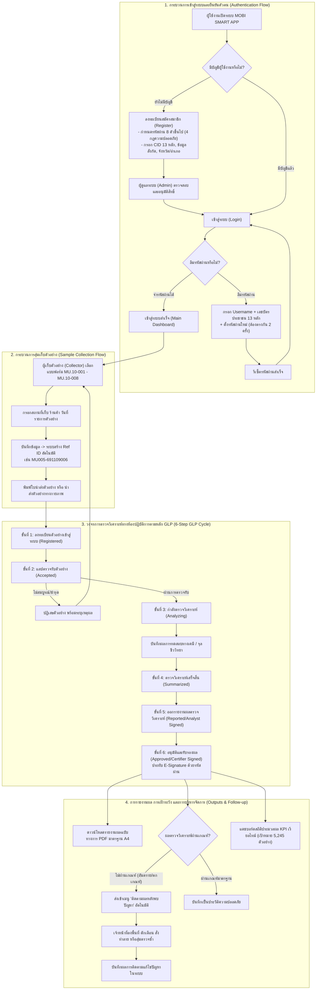

# คู่มือขั้นตอนการปฏิบัติงานมาตรฐาน (Standard Operating Procedure: SOP)
## ระบบตรวจวิเคราะห์และเฝ้าระวังความปลอดภัยด้านอาหาร (MOBI SMART APP)
**หน่วยเคลื่อนที่เพื่อความปลอดภัยด้านอาหาร เขตสุขภาพที่ 10 (เวอร์ชัน 2027)**
**รหัสเอกสาร:** SOP-MOBI-2027-001  
**วันที่ประกาศใช้:** ปีงบประมาณ พ.ศ. 2570  
**สถานะ:** ฉบับสมบูรณ์ ปรับปรุงตามระบบจริง (Production Verified)

---

## 1. วัตถุประสงค์ (Objectives)
1. **มาตรฐานการปฏิบัติงานที่เป็นเลิศ (Standardization):** เพื่อกำหนดมาตรฐาน ขั้นตอน และวิธีปฏิบัติงานที่เป็นหนึ่งเดียวกันทั่วทั้งเขตสุขภาพที่ 10 ในการบันทึก ตรวจรับ ส่งตรวจ วิเคราะห์ผล รับรองผล และเฝ้าระวังความปลอดภัยด้านอาหารผ่านระบบ **MOBI SMART APP**
2. **ความถูกต้องและความน่าเชื่อถือทางห้องปฏิบัติการ (Data Integrity & GLP):** เพื่อให้กระบวนการตรวจวิเคราะห์อาหารทั้งด้านเคมีและจุลชีววิทยาสอดคล้องตามหลักการปฏิบัติการทางห้องปฏิบัติการที่ดี (Good Laboratory Practice: GLP) มีการทวนสอบและลงนามรับรองผลด้วยลายมือชื่ออิเล็กทรอนิกส์ (E-Signature) ที่ตรวจสอบย้อนกลับได้ 100%
3. **การเฝ้าระวังเชิงรุกและการแก้ไขปัญหาทันท่วงที (Proactive Surveillance & Fast Follow-up):** เพื่อเชื่อมโยงข้อมูลระหว่างเจ้าหน้าที่เก็บตัวอย่างในพื้นที่ (สสจ., รพ., สสอ., รพ.สต.) และห้องปฏิบัติการหน่วยเคลื่อนที่ฯ ทำให้สามารถแจ้งเตือนตัวอย่างที่ตกเกณฑ์มาตรฐาน และเข้าดำเนินการแก้ไข ตักเตือน หรือสุ่มตรวจซ้ำได้อย่างรวดเร็ว
4. **การสนับสนุนการตัดสินใจเชิงยุทธศาสตร์ของผู้บริหาร (Executive Decision Support):** เพื่อรวบรวมและประมวลผลข้อมูลสถิติผลการตรวจวิเคราะห์แบบเรียลไทม์ เปรียบเทียบกับเป้าหมายตามยุทธศาสตร์ 5 จังหวัดในเขตสุขภาพที่ 10 ประจำปีงบประมาณ พ.ศ. 2570

---

## 2. ขอบเขต (Scope)
คู่มือการปฏิบัติงานนี้มีผลบังคับใช้กับบุคลากรและหน่วยงานในสังกัดกระทรวงสาธารณสุข และภาคีเครือข่ายความปลอดภัยด้านอาหารในพื้นที่เขตสุขภาพที่ 10 ครอบคลุม 5 จังหวัด ได้แก่ **อุบลราชธานี, ศรีสะเกษ, มุกดาหาร, อำนาจเจริญ, และยโสธร** โดยครอบคลุมกระบวนการตั้งแต่:
1. การลงทะเบียนยืนยันตัวตน การเข้าสู่ระบบ และการกู้คืนรหัสผ่าน
2. การบันทึกข้อมูลการสุ่มเก็บตัวอย่างอาหารและผลิตภัณฑ์สุขภาพตามแบบฟอร์มมาตรฐาน **MU.10-001 ถึง MU.10-008**
3. การตรวจรับตัวอย่างเข้าห้องปฏิบัติการหน่วยเคลื่อนที่ (Sample Receiving & Physical Verification)
4. การบันทึกผลการตรวจวิเคราะห์ทางห้องปฏิบัติการ (Analytical Testing & Result Entry)
5. การลงนามรับรองผลตรวจวิเคราะห์ด้วยลายมือชื่ออิเล็กทรอนิกส์ (Digital Certification / E-Signature)
6. การสืบค้นและติดตามสถานะงานตรวจวิเคราะห์แบบเรียลไทม์ 6 ขั้นตอน (GLP E-Tracking Timeline)
7. การออกและดาวน์โหลดรายงานผลตรวจวิเคราะห์ฉบับทางการในรูปแบบ PDF มาตรฐาน A4 พร้อม QR Code
8. การติดตาม ดำเนินการ และบันทึกผลการแก้ไขปัญหากรณีตัวอย่างตกมาตรฐาน (Corrective Action Follow-up)
9. การส่งออกฐานข้อมูลเชิงลึกในรูปแบบ Excel (.xlsx) และการส่งรายงานสรุปผลอัตโนมัติ
10. การบริหารจัดการแดชบอร์ดสถิติ โหมดนำเสนอผู้บริหาร (Presentation Mode) และการบริหารจัดการบัญชีผู้ใช้งาน

---

## 3. แผนผังการปฏิบัติงาน (Workflow Diagram)



---

## 4. โครงสร้างระดับสิทธิ์ผู้ใช้งาน (User Roles & Permissions)

ระบบ **MOBI SMART APP** มีการจำแนกระดับสิทธิ์ตามโครงสร้างการปฏิบัติงานจริง โดยควบคุมการแสดงผลของเมนูและการอนุญาตเข้าถึงฟังก์ชัน (Role-Based Access Control: RBAC) ดังนี้:

| ระดับสิทธิ์ (Role) | สัญลักษณ์ในระบบ | สิทธิการเข้าถึงเมนูและการทำงาน | ขอบเขตความรับผิดชอบ |
| :--- | :---: | :--- | :--- |
| **1. ผู้เก็บตัวอย่าง (Collector)** | `collector` | • แดชบอร์ดสถิติ<br>• บันทึกการเก็บตัวอย่าง (สร้าง/แก้ไขตัวอย่างตนเอง)<br>• ดาวน์โหลดผลตรวจวิเคราะห์<br>• ติดตามผลหลังพบปัญหา<br>• ตรวจสอบสถานะ (E-Tracking)<br>• ดาวน์โหลดข้อมูล Excel | เจ้าหน้าที่ สสจ., รพ., สสอ., รพ.สต. หรือหน่วยเคลื่อนที่ฯ ผู้รับผิดชอบการสุ่มเก็บตัวอย่างอาหารและส่งตรวจ |
| **2. เจ้าหน้าที่แลป (Lab Staff)** | `lab` | • แดชบอร์ดสถิติ<br>• บันทึกการเก็บตัวอย่าง<br>• **ตรวจสอบตัวอย่าง (แลป)** (ตรวจรับ/ปฏิเสธ)<br>• **ตรวจวิเคราะห์ตัวอย่าง** (ลงผลทดสอบสาร)<br>• **รับรองผลตรวจวิเคราะห์** (ร่วมตรวจสอบ)<br>• ดาวน์โหลดผลตรวจวิเคราะห์<br>• ติดตามผลหลังพบปัญหา<br>• ตรวจสอบสถานะ (E-Tracking)<br>• ดาวน์โหลดข้อมูล Excel | นักวิทยาศาสตร์การแพทย์, เจ้าหน้าที่วิทยาศาสตร์ หรือผู้ช่วยแลปประจำหน่วยเคลื่อนที่ฯ |
| **3. ผู้รับรองผล (Certifier)** | `certifier` | • แดชบอร์ดสถิติ<br>• บันทึกการเก็บตัวอย่าง<br>• **ตรวจสอบตัวอย่าง (แลป)**<br>• **ตรวจวิเคราะห์ตัวอย่าง**<br>• **รับรองผลตรวจวิเคราะห์** (ลงนาม E-Signature รับรองรายงาน)<br>• ดาวน์โหลดผลตรวจวิเคราะห์<br>• ติดตามผลหลังพบปัญหา<br>• ตรวจสอบสถานะ (E-Tracking)<br>• ดาวน์โหลดข้อมูล Excel | หัวหน้ากลุ่มงาน, ผู้จัดการห้องปฏิบัติการ หรือผู้ทรงคุณวุฒิที่ได้รับมอบอำนาจในการอนุมัติผล |
| **4. ผู้บริหาร (Executive)** | `executive` | • แดชบอร์ดสถิติ (เปิดโหมดนำเสนอ & พิมพ์สรุป A4)<br>• ดาวน์โหลดผลตรวจวิเคราะห์ (ดูรายงานทางการ)<br>• ติดตามผลหลังพบปัญหา (ดูผลการเฝ้าระวัง)<br>• ตรวจสอบสถานะ (E-Tracking)<br>• ดาวน์โหลดข้อมูล Excel<br>*(ซ่อนเมนูบันทึกตัวอย่าง, ตรวจรับแลป, ตรวจวิเคราะห์, รับรองผล, และจัดการผู้ใช้)* | ผู้บริหารเขตสุขภาพที่ 10, นายแพทย์ สสจ., ผอ.รพ., หัวหน้าส่วนราชการ เน้นการติดตามตัวชี้วัดเชิงยุทธศาสตร์ |
| **5. ผู้ดูแลระบบ (Admin)** | `admin` | เข้าถึงและใช้งานได้ **ครบทั้ง 10 เมนู** รวมถึง:<br>• **จัดการผู้ใช้งาน (Manage Users)** (อนุมัติ, เปลี่ยนบทบาท, ลบบัญชีผู้ใช้) | ผู้ดูแลระบบสารสนเทศส่วนกลาง ดูแลความมั่นคงปลอดภัยและสิทธิ์ของผู้ใช้งานในระบบ |

---

## 5. ส่วนประกอบหน้าจอและรายการเมนู (System Menus Navigation)

แถบเมนูด้านซ้าย (Sidebar Menu) ของระบบประกอบด้วย 10 เมนูหลัก ดังนี้:

| ลำดับ | ชื่อเมนูในระบบ | หน้าที่หลัก | สิทธิ์ที่สามารถใช้งานได้ |
| :---: | :--- | :--- | :--- |
| **1** | **แดชบอร์ดสถิติ** | แสดงสรุป KPI, เป้าหมาย 5 จังหวัด (5,245 ตัวอย่าง), อัตราความปลอดภัย, โหมดนำเสนอ, พิมพ์สรุปผู้บริหาร | ทุกระดับสิทธิ์ |
| **2** | **บันทึกการเก็บตัวอย่าง** | สุ่มเก็บตัวอย่าง บันทึกข้อมูลตามแบบฟอร์ม MU.10-001 ถึง MU.10-008 และออกเลข Ref ID | Collector, Lab, Certifier, Admin |
| **3** | **ตรวจสอบตัวอย่าง (แลป)** | ตรวจสอบสภาพตัวอย่างทางกายภาพ กดรับตัวอย่างเข้าสู่ห้องปฏิบัติการ หรือปฏิเสธตัวอย่าง | Lab, Certifier, Admin |
| **4** | **ตรวจวิเคราะห์ตัวอย่าง** | ลงผลการตรวจวิเคราะห์สารปนเปื้อนทางเคมีและเชื้อจุลินทรีย์ สรุปผลผ่าน/ไม่ผ่าน | Lab, Certifier, Admin |
| **5** | **รับรองผลตรวจวิเคราะห์** | ทบทวนผลการตรวจทางวิทยาศาสตร์ และลงนามรับรองผลด้วยลายมือชื่ออิเล็กทรอนิกส์ (E-Signature) | Lab, Certifier, Admin *(ลงนามทางการโดย Certifier/Admin)* |
| **6** | **ดาวน์โหลดผลตรวจวิเคราะห์** | ค้นหา พิมพ์ และดาวน์โหลดรายงานผลตรวจวิเคราะห์ฉบับทางการในรูปแบบ PDF มาตรฐาน A4 | ทุกระดับสิทธิ์ |
| **7** | **ติดตามผลหลังพบปัญหา** | บันทึกและติดตามการแก้ไขปัญหาเมื่อพบตัวอย่างตกเกณฑ์มาตรฐาน (เตือน, สั่งทำลาย, ตรวจซ้ำ) | ทุกระดับสิทธิ์ |
| **8** | **ตรวจสอบสถานะ (E-Tracking)** | ติดตามสถานะงานตรวจวิเคราะห์แบบเรียลไทม์ตามไทม์ไลน์ 6 ขั้นตอนของ GLP | ทุกระดับสิทธิ์ |
| **9** | **ดาวน์โหลดข้อมูล Excel** | ส่งออกฐานข้อมูลตัวอย่างทั้งหมดเป็นไฟล์ `.xlsx` และระบบส่งอีเมลสรุปผลประจำงวด | ทุกระดับสิทธิ์ |
| **10** | **จัดการผู้ใช้งาน** | ตรวจสอบ อนุมัติผู้สมัครใหม่ กำหนดบทบาทรายพื้นที่ และจัดการบัญชีผู้ใช้งาน | เฉพาะ Admin เท่านั้น |

---

## 6. รายละเอียดแบบฟอร์มมาตรฐาน MU.10 (Standard Forms MU.10-001 ถึง MU.10-008)

ระบบรองรับแบบฟอร์มการสุ่มตัวอย่างมาตรฐาน 8 ประเภท ตรงตามระเบียบของหน่วยเคลื่อนที่เพื่อความปลอดภัยด้านอาหาร เขตสุขภาพที่ 10:

| รหัสฟอร์ม | ชื่อแบบฟอร์มมาตรฐาน | ขอบเขตการใช้งาน เกณฑ์มาตรฐาน และสารทดสอบหลัก |
| :---: | :--- | :--- |
| **MU.10-001** | **แบบบันทึกการสุ่มตัวอย่างอาหารสดและแปรรูป** | ตรวจสารเคมีกำจัดแมลงในผักสดและผลไม้สด ด้วยชุดทดสอบ **GT Kit** และ **TM/2 Kit** *(ข้อกำหนด: ห้ามสุ่มตรวจถั่วงอกและขิงซอยในฟอร์มนี้)* |
| **MU.10-002** | **แบบบันทึกการสุ่มตัวอย่างอาหาร** | สุ่มตรวจสารปนเปื้อน 5 ชนิดในกลุ่มอาหารทั่วไป (เนื้อสัตว์, อาหารทะเล, ลูกชิ้น, อาหารแปรรูป):<br>1. สารบอแรกซ์ (Borax)<br>2. สารฟอร์มาลิน (Formalin)<br>3. สารฟอกขาว (Sodium hydrosulfite)<br>4. สารกันรา/กรดซาลิซิลิค (Salicylic acid)<br>5. สารเร่งเนื้อแดง (Salbutamol) |
| **MU.10-003** | **แบบบันทึกการสุ่มตัวอย่างน้ำมันและตรวจวัดปริมาณสารโพลาร์ ณ สถานที่จำหน่าย** | ตรวจวัดปริมาณสารโพลาร์ในน้ำมันทอดอาหาร ณ สถานที่จำหน่ายโดยตรง ด้วยเครื่องวัดดิจิทัล (**Testo 270** หรือ **Ebro**) เกณฑ์มาตรฐาน: สารโพลาร์ต้องไม่เกิน 25% |
| **MU.10-004** | **แบบบันทึกการเก็บตัวอย่างน้ำมันทอดซ้ำ** | ตรวจประเมินน้ำมันทอดซ้ำด้วยชุดทดสอบรวดเร็ว (Test Kit) และรองรับการบันทึกผลการตรวจติดตามซ้ำต่อเนื่องได้สูงสุด **7 ครั้ง** เพื่อเฝ้าระวังพฤติกรรมการเปลี่ยนถ่ายน้ำมัน |
| **MU.10-005** | **แบบบันทึกการเก็บตัวอย่างเกลือบริโภค** | ตรวจวัดปริมาณสารไอโอดีนในเกลือบริโภค (เกณฑ์มาตรฐานตามกฎหมาย 20 - 40 ppm) ด้วยชุดทดสอบ I-Kit หรือ Titration *(ปรับปรุงฟอร์มใหม่: มี 5 แถวรายการตัวอย่างพอดี 1 หน้ากระดาษ A4 พร้อมกล่องลงชื่อ 3 ฝ่ายในหน้าแรก)* |
| **MU.10-006** | **แบบบันทึกเก็บตัวอย่างน้ำบริโภคจากตู้น้ำดื่มหยอดเหรียญ** | ตรวจประเมินคุณภาพน้ำดื่มจากตู้น้ำหยอดเหรียญ: กายภาพ (สี กลิ่น รส ความขุ่น), ค่าความเป็นกรด-ด่าง (pH), ปริมาณสารแขวนลอย (TDS) และเชื้อโคลิฟอร์มแบคทีเรีย |
| **MU.10-007** | **แบบบันทึกเก็บตัวอย่างเชื้อโคลิฟอร์มแบคทีเรียขั้นต้น** | โครงการอาหารสะอาด รสชาติอร่อย (**Clean Food Good Taste**) สุ่มตรวจเชื้อโคลิฟอร์มแบคทีเรียในภาชนะสัมผัสอาหาร อุปกรณ์ และมือผู้สัมผัสอาหาร ด้วยชุดทดสอบ อ.13 (เกณฑ์ผ่าน > ร้อยละ 90) |
| **MU.10-008** | **แบบบันทึกการสุ่มตัวอย่างผลิตภัณฑ์สุขภาพชุมชน** | ตรวจสอบผลิตภัณฑ์สุขภาพชุมชน (OTOP, วิสาหกิจชุมชน): การแสดงฉลาก, สถานะเลข อย./มผช., วันเดือนปีที่ผลิต/หมดอายุ, ปริมาณน้ำหนักสุทธิ และสภาพบรรจุภัณฑ์ |

---

## 7. ขั้นตอนการปฏิบัติงานแต่ละเมนูอย่างละเอียด (Detailed Procedures)

### 7.1 การจัดการบัญชีและการเข้าสู่ระบบ (Authentication & Security)
1. **การลงทะเบียนสมัครสมาชิก (Registration):**
   - คลิกปุ่ม **"สมัครสมาชิก"** ที่หน้าแรก
   - กรอกข้อมูลส่วนตัว: ชื่อ-นามสกุล, Username, เลขประจำตัวประชาชน (CID 13 หลัก), วันเดือนปีเกิด, ตำแหน่ง, หน่วยงาน, ที่อยู่ (จังหวัด, อำเภอ, ตำบล)
   - กำหนด **รหัสผ่าน (Password)** โดยต้องผ่านเกณฑ์ความปลอดภัยขั้นต่ำ 8 ตัวอักษร และ 4 เงื่อนไข (ตัวพิมพ์ใหญ่, ตัวพิมพ์เล็ก, ตัวเลข, อักขระพิเศษ) ซึ่งระบบจะแสดงแถบวัดความแข็งแรง (Password Strength Meter) แบบเรียลไทม์
   - กดยืนยันการสมัคร ข้อมูลจะส่งไปยังตารางรออนุมัติของ Admin
2. **การเข้าสู่ระบบ (Login):**
   - กรอก Username และ Password
   - สามารถเลือก **"จดจำการเข้าสู่ระบบ"** ได้
   - กดปุ่ม **"เข้าสู่ระบบ"** เพื่อเข้าสู่หน้าแดชบอร์ดหลัก
3. **การกู้คืนรหัสผ่าน (Forgot Password):**
   - คลิก **"ลืมรหัสผ่านใช่หรือไม่?"**
   - กรอกข้อมูล 4 ช่อง:
     1. **Username:** ชื่อผู้ใช้งาน
     2. **เลขบัตรประชาชน:** 13 หลักที่ลงทะเบียนไว้
     3. **รหัสผ่านใหม่:** ต้องผ่านเกณฑ์ความปลอดภัย 8 ตัวอักษร
     4. **ยืนยันรหัสผ่านใหม่:** กรอกให้ตรงกับรหัสผ่านใหม่
   - กดปุ่ม **"รีเซ็ตรหัสผ่าน"** เมื่อระบบตรวจสอบว่า Username และ CID ถูกต้อง รหัสผ่านใหม่จะถูกบันทึกและสามารถเข้าสู่ระบบได้ทันที

### 7.2 เมนู แดชบอร์ดสถิติ (Dashboard)
1. **การตั้งค่าตัวกรองข้อมูล (Filter Panel):**
   - **รอบเวลา:** เลือกรายไตรมาส (Q1: ต.ค.-ธ.ค., Q2: ม.ค.-มี.ค., Q3: เม.ย.-มิ.ย., Q4: ก.ค.-ก.ย.) หรือทั้งปีงบประมาณ 2570
   - **พื้นที่:** เลือกภาพรวมเขตสุขภาพที่ 10 หรือเจาะจงรายจังหวัด (อุบลราชธานี, ศรีสะเกษ, มุกดาหาร, อำนาจเจริญ, ยโสธร)
   - **หน่วยตรวจ:** เลือกหน่วยงานเก็บตัวอย่างเฉพาะแห่ง
   - **สถานะ:** กรองตามสถานะการตรวจวิเคราะห์ทางห้องปฏิบัติการ
2. **ตัวชี้วัดหลัก (KPI Summary Cards):**
   - **จำนวนตัวอย่างทั้งหมด:** จำนวนตัวอย่างที่บันทึกเข้าสู่ระบบ
   - **ผ่านเกณฑ์มาตรฐาน:** ตัวอย่างที่มีผลตรวจปลอดภัย
   - **ไม่ผ่านเกณฑ์ (ตกมาตรฐาน):** ตัวอย่างที่พบสารปนเปื้อนหรือเชื้อจุลินทรีย์เกินเกณฑ์
   - **รอผลตรวจวิเคราะห์:** ตัวอย่างที่อยู่ในขั้นตอนของแลป
   - **อัตราความปลอดภัย (% Safety Rate):** คำนวณเป็นร้อยละของตัวอย่างที่ผ่านเกณฑ์
   - **ระยะเวลาการตรวจเฉลี่ย (TAT: Turnaround Time):** เวลาเฉลี่ยตั้งแต่ตรวจรับจนถึงอนุมัติผล
3. **เป้าหมายเชิงยุทธศาสตร์ ปีงบประมาณ 2570 (Strategic Targets):**
   - ระบบตั้งเป้าหมายรวมของเขตสุขภาพที่ 10 ไว้ที่ **5,245 ตัวอย่าง** (เคมี 4,895 + จุลินทรีย์ 350)
   - กระจายเป้าหมายรายจังหวัด:
     - **อุบลราชธานี:** 1,750 ตัวอย่าง (เคมี 1,630 / จุลินทรีย์ 120)
     - **ศรีสะเกษ:** 1,540 ตัวอย่าง (เคมี 1,430 / จุลินทรีย์ 110)
     - **มุกดาหาร:** 670 ตัวอย่าง (เคมี 630 / จุลินทรีย์ 40)
     - **อำนาจเจริญ:** 670 ตัวอย่าง (เคมี 630 / จุลินทรีย์ 40)
     - **ยโสธร:** 615 ตัวอย่าง (เคมี 575 / จุลินทรีย์ 40)
4. **ฟังก์ชันพิเศษสำหรับผู้บริหาร:**
   - **โหมดนำเสนอ (Presentation Mode):** ขยายหน้าจอแดชบอร์ดเต็มจอเพื่อฉายในการประชุม
   - **พิมพ์สรุปผู้บริหาร (Print Executive Summary):** สรุปผลสถานการณ์ความปลอดภัยอาหารใน 1 หน้ากระดาษ A4

### 7.3 เมนู บันทึกการเก็บตัวอย่าง (Sample Record)
1. กดปุ่ม **"บันทึกตัวอย่างใหม่"**
2. เลือกประเภทแบบฟอร์มที่ต้องการใช้งาน (**MU.10-001 ถึง MU.10-008**)
3. กรอกข้อมูลส่วนหัวของแบบฟอร์ม:
   - หน่วยงานผู้สุ่มเก็บ, สถานที่เก็บตัวอย่าง/ชื่อร้านค้า, ตลาด/ชุมชน
   - ตำบล, อำเภอ, จังหวัด, วันที่ทำการสุ่มเก็บ
   - ชื่อ-นามสกุล และตำแหน่งของผู้สุ่มเก็บตัวอย่าง
4. บันทึกรายการตัวอย่างในตาราง (รองรับการเพิ่มหลายรายการในใบนำส่งเดียวกัน):
   - ชื่อตัวอย่างอาหาร/ผลิตภัณฑ์, แหล่งผลิต/ตราสินค้า, เลขสารบบ (ถ้ามี), วันผลิต/หมดอายุ
5. สำหรับ **MU.10-005 (เกลือบริโภค)**: ระบบกำหนดจำนวนรายการไว้ที่ 5 แถวพอดี เพื่อให้เอกสารพิมพ์ออกมาสวยงามใน 1 หน้า A4
6. กดปุ่ม **"บันทึกข้อมูล"** ระบบจะสร้างรหัสอ้างอิง `Ref ID` อัตโนมัติ (เช่น `MU005-691109006`) และเปลี่ยนสถานะเป็น `registered`

### 7.4 เมนู ตรวจสอบตัวอย่าง (Lab Verify) - สิทธิ์ Lab / Certifier / Admin
1. ระบบแสดงรายการตัวอย่างที่ส่งเข้ามาใหม่ (สถานะ `registered`) พร้อม Badge ตัวเลขแจ้งเตือน
2. เจ้าหน้าที่แลปตรวจสอบสภาพตัวอย่างทางกายภาพ ความสมบูรณ์ของภาชนะบรรจุ และความถูกต้องของข้อมูล
3. ดำเนินการ:
   - **ตรวจรับตัวอย่าง (Accept):** กดปุ่มตรวจรับ สถานะจะเปลี่ยนเป็น `accepted` และส่งต่อไปยังขั้นตอนการตรวจวิเคราะห์
   - **ปฏิเสธตัวอย่าง (Reject):** หากตัวอย่างเน่าเสีย ชำรุด หรือข้อมูลไม่ถูกต้อง ให้กดปฏิเสธพร้อมระบุเหตุผลเพื่อส่งกลับให้ผู้เก็บแก้ไข

### 7.5 เมนู ตรวจวิเคราะห์ตัวอย่าง (Lab Analysis) - สิทธิ์ Lab / Certifier / Admin
1. เลือกรายการตัวอย่างที่ผ่านการตรวจรับแล้ว
2. สถานะตัวอย่างจะปรับเป็น `analyzing` (กำลังตรวจวิเคราะห์)
3. ป้อนผลการตรวจทางห้องปฏิบัติการตามพารามิเตอร์ของสารทดสอบแต่ละชนิด:
   - ผลตรวจเชิงคุณภาพ (ตรวจไม่พบ / ตรวจพบ)
   - ผลตรวจเชิงปริมาณ (เช่น ค่าสารโพลาร์ %, ค่าไอโอดีน ppm)
4. ระบบประเมินผลอัตโนมัติตามเกณฑ์มาตรฐานสาธารณสุข และสรุปผล:
   - **ผ่านเกณฑ์มาตรฐาน**
   - **ไม่ผ่านเกณฑ์มาตรฐาน**
5. ระบุวันที่ตรวจวิเคราะห์ ชื่อผู้ตรวจวิเคราะห์ และกดปุ่ม **"บันทึกผลตรวจวิเคราะห์"** สถานะจะเปลี่ยนเป็น `summarized` และส่งต่อรายงานไปยังสถานะ `reported`

### 7.6 เมนู รับรองผลตรวจวิเคราะห์ (Lab Certify) - สิทธิ์ Certifier / Admin
1. เข้าตรวจสอบรายการผลตรวจวิเคราะห์ที่สรุปผลเรียบร้อยแล้ว
2. ตรวจสอบความถูกต้องของพารามิเตอร์ ผลการทดสอบ และความสอดคล้องทางวิชาการ
3. กดปุ่ม **"อนุมัติและรับรองรายงานผล"**
4. ยืนยันรหัสผ่านเพื่อประทับ **ลายมือชื่ออิเล็กทรอนิกส์ (E-Signature)** ของผู้รับรองลงในเอกสาร
5. เมื่อรับรองสำเร็จ สถานะจะเปลี่ยนเป็น `approved` ระบบจะบันทึกวันที่-เวลา และผู้รับรองผลไว้อย่างสมบูรณ์

### 7.7 เมนู ดาวน์โหลดผลตรวจวิเคราะห์ (Download Results)
1. ค้นหาเอกสารด้วย Ref ID, ชื่ออาหาร, ร้านค้า, หรือช่วงวันที่
2. กดปุ่ม **"PDF"** เพื่อเปิดหน้าต่างดูตัวอย่างเอกสารรายงานผลการตรวจวิเคราะห์ฉบับทางการ
3. โครงสร้างเอกสาร PDF:
   - ส่วนหัว: ตราสัญลักษณ์กระทรวงสาธารณสุข และชื่อหน่วยงาน
   - ข้อมูลการสุ่มเก็บ: สถานที่ ร้านค้า วันที่สุ่มเก็บ
   - ตารางผลการตรวจวิเคราะห์ตามแบบฟอร์มมาตรฐาน
   - ส่วนท้าย: กล่องลงลายมือชื่อ 3 ฝ่าย ได้แก่ **ผู้เก็บตัวอย่าง, ผู้ตรวจวิเคราะห์, และผู้รับรองรายงานผล** (พร้อมลายมือชื่อ E-Signature)
   - QR Code สำหรับสแกนตรวจสอบความถูกต้องของเอกสาร
4. ผู้ใช้งานสามารถสั่งพิมพ์ (Print) หรือบันทึกเป็นไฟล์ PDF ได้ทันที

### 7.8 เมนู ติดตามผลหลังพบปัญหา (Follow-up)
1. เมื่อตัวอย่างอาหารมีผลตรวจเป็น **"ไม่ผ่านเกณฑ์มาตรฐาน"** ระบบจะส่งข้อมูลเข้ามายังเมนูนี้โดยอัตโนมัติ
2. เจ้าหน้าที่สาธารณสุขในพื้นที่สามารถเข้ามาตรวจสอบข้อมูลและวางแผนลงพื้นที่แก้ไขปัญหา
3. บันทึกผลการติดตามการดำเนินงาน:
   - การให้คำแนะนำและการตักเตือนผู้ประกอบการ
   - การสั่งหยุดจำหน่ายหรือการทำลายอาหารที่มีปัญหา
   - การกำหนดวันนัดหมายสุ่มเก็บตัวอย่างซ้ำ (Re-sampling)
4. เมื่อแก้ไขปัญหาเสร็จสิ้น ให้กดบันทึกและปิดเคสการติดตาม

### 7.9 เมนู ตรวจสอบสถานะ (E-Tracking) - ไทม์ไลน์ 6 ขั้นตอนของ GLP
ผู้ใช้งานสามารถค้นหาสถานะของตัวอย่างได้แบบเรียลไทม์ โดยระบบจะแสดงไทม์ไลน์ความคืบหน้า 6 ขั้นตอนตามหลัก Good Laboratory Practice ดังนี้:

```text
[1. บันทึกตัวอย่าง] ──> [2. ตรวจรับตัวอย่าง] ──> [3. กำลังตรวจวิเคราะห์]
    (registered)            (accepted)              (analyzing)
         │                       │                       │
         ▼                       ▼                       ▼
[4. ตรวจเสร็จสิ้น] ──> [5. ออกรายงานผล]  ──> [6. อนุมัติและรับรองผล]
   (summarized)             (reported)              (approved)
                                                  (พร้อมดาวน์โหลด PDF)
```

1. **ขั้นที่ 1: บันทึกตัวอย่างเข้าสู่ระบบ (`registered`)** - ผู้เก็บตัวอย่างบันทึกข้อมูลและสร้างเลข Ref ID เรียบร้อย
2. **ขั้นที่ 2: ห้องปฏิบัติการตรวจสอบรับตัวอย่าง (`accepted`)** - แลปตรวจสอบสภาพตัวอย่างและกดรับเข้าคลังวิเคราะห์
3. **ขั้นที่ 3: อยู่ระหว่างการตรวจวิเคราะห์ (`analyzing`)** - นักวิทยาศาสตร์การแพทย์ดำเนินการทดสอบทางเคมี/จุลินทรีย์
4. **ขั้นที่ 4: ตรวจเสร็จสิ้น (`summarized`)** - บันทึกผลทดสอบครบถ้วนและประเมินผลผ่าน/ไม่ผ่าน
5. **ขั้นที่ 5: ออกรายงานผลตรวจวิเคราะห์ (`reported` / `analyst_signed`)** - ผู้ตรวจวิเคราะห์ลงนามรับรองผลชั้นต้น
6. **ขั้นที่ 6: อนุมัติและรับรองรายงานผล (`approved`)** - ผู้รับรองผลลงนาม E-Signature อนุมัติออกเอกสารทางการ พร้อมปุ่มกดดาวน์โหลดไฟล์ PDF ทันที

### 7.10 เมนู ดาวน์โหลดข้อมูล Excel (Data Download)
1. กำหนดเงื่อนไขตัวกรองข้อมูลที่ต้องการส่งออก (ช่วงวันที่, จังหวัด, ประเภทฟอร์ม, ผลการตรวจ)
2. กดปุ่ม **"Export to Excel"** เพื่อดาวน์โหลดไฟล์ตารางข้อมูล `.xlsx` สำหรับนำไปวิเคราะห์เพิ่มเติม
3. ฟังก์ชันส่งอีเมลสรุปผล: ผู้มีสิทธิ์สามารถกดส่งรายงานสถิติสรุปผลประจำเดือนไปยังผู้บริหารผ่านระบบอีเมลอัตโนมัติ

### 7.11 เมนู จัดการผู้ใช้งาน (Manage Users) - สิทธิ์ Admin
1. **การอนุมัติผู้ใช้งานใหม่:** ตรวจสอบรายชื่อในตารางรออนุมัติ ตรวจสอบความถูกต้องของสังกัดและเลขบัตรประชาชน แล้วกด **"อนุมัติ"**
2. **การจัดการบทบาท (Role Management):** ค้นหารายชื่อผู้ใช้ตามจังหวัดและอำเภอ สามารถปรับเปลี่ยนสิทธิ์ระหว่าง Collector, Lab, Certifier, และ Executive
3. **การระงับสิทธิ์และลบผู้ใช้งาน:** สำหรับผู้ใช้งานที่ย้ายสังกัดหรือเกษียณอายุราชการ เพื่อความปลอดภัยของข้อมูล

---

## 8. การรักษาความมั่นคงปลอดภัยและความสอดคล้องตามมาตรฐาน (Security & Compliance)
1. **การยืนยันตัวตนและความปลอดภัยของรหัสผ่าน:** บังคับใช้นโยบายรหัสผ่านขั้นต่ำ 8 ตัวอักษรพร้อมความซับซ้อน 4 ด้าน และเข้ารหัสข้อมูลสำคัญ
2. **การควบคุมการเข้าถึงตามหน้าที่ (Strict RBAC):** ป้องกันไม่ให้ผู้ที่ไม่มีสิทธิ์เข้าถึงหรือแก้ไขข้อมูล โดยเฉพาะการลงผลแลปและการอนุมัติรับรองผล
3. **ความสมบูรณ์ของเอกสารอิเล็กทรอนิกส์:** รายงานผลทุกฉบับมีรหัสอ้างอิงเฉพาะ มีลายมือชื่ออิเล็กทรอนิกส์กำกับ และมี QR Code สำหรับตรวจสอบย้อนกลับไปยังฐานข้อมูลจริง ป้องกันการปลอมแปลงเอกสาร
4. **การจัดการเวอร์ชันและแคช (Cache Invalidation):** ระบบมีกลไกป้องกันปัญหาหน้าจอค้างเวอร์ชันเก่า เพื่อให้ผู้ใช้งานได้รับข้อมูลที่อัปเดตตรงกันแบบเรียลไทม์

---

*เอกสารควบคุมคุณภาพ ระบบสารสนเทศหน่วยเคลื่อนที่เพื่อความปลอดภัยด้านอาหาร เขตสุขภาพที่ 10*  
*ลิขสิทธิ์ของ: เขตสุขภาพที่ 10 กระทรวงสาธารณสุข (MOBI SMART APP Version 2027)*