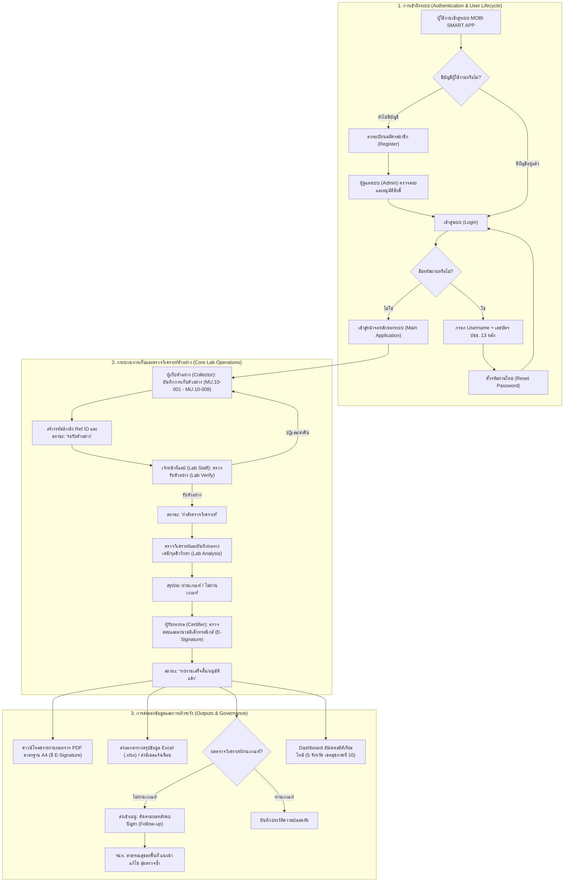

# คู่มือขั้นตอนการปฏิบัติงานมาตรฐาน (Standard Operating Procedure: SOP)
## ระบบตรวจวิเคราะห์และเฝ้าระวังความปลอดภัยด้านอาหาร (MOBI SMART APP)
**หน่วยเคลื่อนที่เพื่อความปลอดภัยด้านอาหาร เขตสุขภาพที่ 10 (เวอร์ชัน 2027)**

---

## 1. วัตถุประสงค์ (Objectives)
1. เพื่อกำหนดขั้นตอนและแนวทางการปฏิบัติงานที่เป็นมาตรฐานเดียวกัน (Standard Operating Procedure) ในการใช้งานระบบ **MOBI SMART APP** สำหรับบันทึก ตรวจวิเคราะห์ รับรองผล และเฝ้าระวังความปลอดภัยด้านอาหาร
2. เพื่อยกระดับความถูกต้อง ความรวดเร็ว และความโปร่งใสในการจัดการข้อมูลตัวอย่างอาหารและผลิตภัณฑ์สุขภาพในพื้นที่เขตสุขภาพที่ 10 (ศรีสะเกษ, อุบลราชธานี, อำนาจเจริญ, มุกดาหาร, ยโสธร)
3. เพื่อให้ผู้ปฏิบัติงานทุกระดับ (ผู้เก็บตัวอย่าง, เจ้าหน้าที่ห้องปฏิบัติการ, ผู้รับรองผล, ผู้บริหาร, และผู้ดูแลระบบ) สามารถปฏิบัติงานตามขอบเขตหน้าที่ได้อย่างถูกต้อง มีประสิทธิภาพ และลดข้อผิดพลาดในกระบวนการทำงาน

---

## 2. ขอบเขต (Scope)
คู่มือการปฏิบัติงานนี้ครอบคลุมการปฏิบัติงานในระบบ **MOBI SMART APP** ตั้งแต่:
1. การลงทะเบียนสมัครสมาชิกและการยืนยันตัวตนเข้าใช้งานระบบ
2. การบันทึกข้อมูลการสุ่มเก็บตัวอย่างอาหารตามแบบบันทึกมาตรฐาน (MU.10-001 ถึง MU.10-008)
3. กระบวนการตรวจรับตัวอย่างเข้าห้องปฏิบัติการหน่วยเคลื่อนที่ฯ
4. การบันทึกผลการตรวจวิเคราะห์ทางห้องปฏิบัติการ
5. การลงนามรับรองผลตรวจวิเคราะห์ด้วยลายมือชื่ออิเล็กทรอนิกส์ (E-Signature)
6. การสืบค้น ตรวจสอบสถานะการตรวจวิเคราะห์แบบเรียลไทม์ (E-Tracking)
7. การดาวน์โหลดรายงานผลตรวจวิเคราะห์ในรูปแบบ PDF มาตรฐาน และการส่งออกข้อมูล Excel
8. การติดตามแก้ไขปัญหาเมื่อพบตัวอย่างไม่ผ่านเกณฑ์มาตรฐานความปลอดภัย
9. การประมวลผลและการใช้ประโยชน์จากแดชบอร์ดสถิติเชิงบริหาร

---

## 3. แผนผังการปฏิบัติงาน (Workflow Diagram)



---

## 4. โครงสร้างและระดับสิทธิ์ผู้ใช้งาน (User Roles & Permissions)

| ระดับสิทธิ์ (Role) | คำอธิบายและหน้าที่รับผิดชอบ | เมนูที่สามารถเข้าถึงและใช้งานได้ |
| :--- | :--- | :--- |
| **1. ผู้เก็บตัวอย่าง (Collector)** | เจ้าหน้าที่ สสจ., รพ., สสอ., รพ.สต. หรือหน่วยเคลื่อนที่ ที่ปฏิบัติงานสุ่มเก็บตัวอย่างอาหารในพื้นที่ | • แดชบอร์ดสถิติ<br>• บันทึกการเก็บตัวอย่าง (สร้าง/แก้ไขตัวอย่างของตนเอง)<br>• ดาวน์โหลดผลตรวจวิเคราะห์<br>• ติดตามผลหลังพบปัญหา<br>• ตรวจสอบสถานะ (E-Tracking)<br>• ดาวน์โหลดข้อมูล Excel |
| **2. เจ้าหน้าที่แลป (Lab Staff)** | นักวิทยาศาสตร์การแพทย์, เจ้าหน้าที่ห้องปฏิบัติการหน่วยเคลื่อนที่เพื่อความปลอดภัยด้านอาหาร | • แดชบอร์ดสถิติ<br>• บันทึกการเก็บตัวอย่าง<br>• **ตรวจสอบตัวอย่าง (แลป)** (ตรวจรับ/ปฏิเสธ)<br>• **ตรวจวิเคราะห์ตัวอย่าง** (ลงผลตรวจสารปนเปื้อน)<br>• ดาวน์โหลดผลตรวจวิเคราะห์<br>• ติดตามผลหลังพบปัญหา<br>• ตรวจสอบสถานะ (E-Tracking)<br>• ดาวน์โหลดข้อมูล Excel |
| **3. ผู้รับรองผล (Certifier)** | ผู้จัดการห้องปฏิบัติการ หรือผู้ได้รับมอบหมายให้ลงนามรับรองความถูกต้องของรายงานผล | • แดชบอร์ดสถิติ<br>• บันทึกการเก็บตัวอย่าง<br>• ตรวจสอบตัวอย่าง (แลป)<br>• ตรวจวิเคราะห์ตัวอย่าง<br>• **รับรองผลตรวจวิเคราะห์** (ลงนาม E-Signature)<br>• ดาวน์โหลดผลตรวจวิเคราะห์<br>• ติดตามผลหลังพบปัญหา<br>• ตรวจสอบสถานะ (E-Tracking)<br>• ดาวน์โหลดข้อมูล Excel |
| **4. ผู้บริหาร (Executive)** | ผู้บริหารเขตสุขภาพที่ 10, ผู้บริหารศูนย์วิทยาศาสตร์การแพทย์, นายแพทย์ สสจ. | • แดชบอร์ดสถิติ (พร้อมปุ่มสรุปผลผู้บริหาร Executive Brief)<br>• ดาวน์โหลดผลตรวจวิเคราะห์<br>• ติดตามผลหลังพบปัญหา<br>• ตรวจสอบสถานะ (E-Tracking)<br>• ดาวน์โหลดข้อมูล Excel |
| **5. ผู้ดูแลระบบ (Admin)** | ผู้ดูแลระบบสารสนเทศส่วนกลางของหน่วยเคลื่อนที่ฯ เขตสุขภาพที่ 10 | เข้าถึงได้ **ทุกเมนูในระบบ** รวมถึง:<br>• **จัดการผู้ใช้งาน (Manage Users)** (อนุมัติ, เปลี่ยนบทบาท, ลบผู้ใช้งาน) |

---

## 5. ส่วนประกอบหน้าจอและเมนูการใช้งาน (System Menus)

เมื่อเข้าสู่ระบบ แถบเมนูด้านซ้าย (Sidebar Navigation) ประกอบด้วย 10 เมนูหลัก ดังนี้:

```text
[ แดชบอร์ดสถิติ ]               -> วิเคราะห์ข้อมูล สถิติภาพรวม 5 จังหวัด, KPI, SLA
[ บันทึกการเก็บตัวอย่าง ]        -> สุ่มเก็บตัวอย่างตามฟอร์ม MU.10-001 ถึง MU.10-008
[ ตรวจสอบตัวอย่าง (แลป) ]       -> เฉพาะ Lab/Admin: ตรวจรับตัวอย่างเข้าห้องปฏิบัติการ
[ ตรวจวิเคราะห์ตัวอย่าง ]        -> เฉพาะ Lab/Admin: ลงผลตรวจสารปนเปื้อนและสรุปผล
[ รับรองผลตรวจวิเคราะห์ ]       -> เฉพาะ Certifier/Admin: ลงนามรับรอง E-Signature
[ ดาวน์โหลดผลตรวจวิเคราะห์ ]   -> พิมพ์และดาวน์โหลดเอกสาร PDF ฟอร์มมาตรฐาน A4
[ ติดตามผลหลังพบปัญหา ]         -> เฝ้าระวังตัวอย่างไม่ผ่านเกณฑ์ และบันทึกผลการแก้ไข
[ ตรวจสอบสถานะ (E-Tracking) ]   -> ค้นหาและติดตามสถานะตัวอย่างแบบเรียลไทม์ (4 ขั้นตอน)
[ ดาวน์โหลดข้อมูล Excel ]       -> ส่งออกไฟล์ Excel (.xlsx) และระบบส่งอีเมลสรุปผล
[ จัดการผู้ใช้งาน ]             -> เฉพาะ Admin: ตรวจสอบ อนุมัติ และจัดการสิทธิ์ผู้ใช้งาน
```

---

## 6. ขั้นตอนการปฏิบัติงานแต่ละเมนูอย่างละเอียด (Detailed Operating Procedures)

### 6.1 ขั้นตอนการเข้าถึงระบบและการจัดการบัญชี (Account Lifecycle)
1. **การลงทะเบียนสมัครสมาชิก (Register):**
   - เข้าหน้าเว็บไซต์ คลิกปุ่ม **"สมัครสมาชิก"** บนการ์ดเข้าสู่ระบบ
   - กรอกข้อมูลให้ครบถ้วน: ชื่อ-นามสกุล, Username, รหัสผ่าน (ขั้นต่ำ 6 หลัก), เลขบัตรประชาชน (13 หลัก), วันเดือนปีเกิด, ตำแหน่ง, หน่วยงาน, ที่อยู่ (จังหวัด, อำเภอ, ตำบล), และระบุบทบาทที่ขอใช้งาน
   - กดยืนยันการสมัคร ระบบจะส่งคำขอไปยังผู้ดูแลระบบ (Admin) เพื่อรอการตรวจสอบและอนุมัติ
2. **การเข้าสู่ระบบ (Login):**
   - กรอก **Username** และ **Password**
   - สามารถเลือกติ๊ก **"จดจำการเข้าสู่ระบบ"** เพื่อความสะดวกในการใช้งาน
   - กดปุ่ม **"เข้าสู่ระบบ"**
3. **การลืมรหัสผ่าน (Forgot Password):**
   - คลิกข้อความ **"ลืมรหัสผ่านใช่หรือไม่?"**
   - กรอก **Username** และ **เลขบัตรประชาชน 13 หลัก** ที่เคยลงทะเบียนไว้เพื่อยืนยันตัวตน
   - กำหนด **รหัสผ่านใหม่** และยืนยันรหัสผ่านใหม่อีกครั้ง
   - กดปุ่ม **"รีเซ็ตรหัสผ่าน"** เมื่อระบบตรวจสอบข้อมูลถูกต้อง รหัสผ่านใหม่จะมีผลทันที

---

### 6.2 เมนู แดชบอร์ดสถิติ (Dashboard)
เป็นศูนย์กลางการประมวลผลข้อมูลความปลอดภัยด้านอาหารของเขตสุขภาพที่ 10
1. **การใช้ตัวกรองข้อมูล (Filter Controls):**
   - **ช่วงเวลา:** เลือกรอบเดือน หรือ ปีงบประมาณ พ.ศ. 2570
   - **พื้นที่:** กรองดูภาพรวมทั้งเขต 10 หรือเจาะจงรายจังหวัด (ศรีสะเกษ, อุบลราชธานี, อำนาจเจริญ, มุกดาหาร, ยโสธร)
   - **สารที่ตรวจ:** กรองวิเคราะห์เฉพาะสารปนเปื้อน เช่น บอแรกซ์, ฟอร์มาลิน, ยาฆ่าแมลง, สารโพลาร์, สารไอโอดีน ฯลฯ
2. **ตัวชี้วัดหลัก (KPI Cards):**
   - แสดงตัวเลขสรุป: ตัวอย่างทั้งหมด, ผ่านเกณฑ์มาตรฐาน, ไม่ผ่านเกณฑ์, อยู่ระหว่างตรวจวิเคราะห์, และรับรองผลเสร็จสิ้น
   - คำนวณร้อยละความปลอดภัยอาหาร (Safety Rate %) อัตโนมัติ
3. **แผนภูมิกราฟวิเคราะห์ (Analytics Charts):**
   - **แนวโน้มความปลอดภัย (Safety Trend):** วิเคราะห์แนวโน้มผลการตรวจเปรียบเทียบแต่ละเดือน
   - **เปรียบเทียบรายจังหวัด (Provincial Performance):** กราฟแท่งแสดงปริมาณตัวอย่างที่ตรวจและอัตราการผ่านเกณฑ์ของ 5 จังหวัด
   - **จัดอันดับสารปนเปื้อน (Hazard Ranking):** วิเคราะห์สารปนเปื้อนที่พบไม่ผ่านเกณฑ์บ่อยที่สุด เพื่อชี้เป้าความเสี่ยง
   - **SLA & TAT (Turnaround Time):** ติดตามระยะเวลาการตรวจวิเคราะห์ว่าแล้วเสร็จทันตามกำหนด SLA หรือไม่
4. **สรุปผลสำหรับผู้บริหาร (Executive Brief Modal):**
   - คลิกปุ่มสรุปผลผู้บริหารเพื่อแสดงสรุปประเด็นสำคัญ ตัวเลขความปลอดภัยสูงสุด/ต่ำสุด และสารตกค้างที่ต้องเฝ้าระวังเร่งด่วน

---

### 6.3 เมนู บันทึกการเก็บตัวอย่าง (Sample Record)
ใช้สำหรับเจ้าหน้าที่เก็บตัวอย่างในการนำส่งข้อมูลอาหารเข้าสู่ระบบ
1. คลิกปุ่ม **"บันทึกตัวอย่างใหม่"**
2. เลือก **ประเภทแบบบันทึก (Form Type):**
   - **MU.10-001:** อาหารสดและแปรรูป (ตรวจหาสารปนเปื้อนทั่วไป)
   - **MU.10-002:** ผลิตภัณฑ์อาหารแปรรูป
   - **MU.10-003:** น้ำมันทอดอาหาร (บันทึกสารโพลาร์ และพฤติกรรมการเปลี่ยนถ่ายน้ำมัน)
   - **MU.10-004:** ภาชนะสัมผัสอาหาร / สุขาภิบาล
   - **MU.10-005:** เกลือบริโภคเสริมไอโอดีน (ตรวจวัดค่าไอโอดีน ppm)
   - **MU.10-006:** น้ำบริโภคและน้ำแข็ง
   - **MU.10-007:** การตรวจประเมินสุขาภิบาลอาหาร
   - **MU.10-008:** ผลิตภัณฑ์สุขภาพชุมชน
3. กรอกข้อมูลส่วนหัว: หน่วยงานที่เก็บ, สถานที่เก็บ, ร้านค้า, วันที่เก็บ, ตำบล, อำเภอ, จังหวัด, ชื่อผู้เก็บตัวอย่าง และตำแหน่ง
4. เพิ่มรายการตัวอย่างในตาราง (สามารถเพิ่มได้หลายตัวอย่างต่อชุดบันทึก):
   - ระบุชื่ออาหาร/ผลิตภัณฑ์, แหล่งที่มา/ผู้ผลิต, เลขสารบบอาหาร (ถ้ามี), วันผลิต/หมดอายุ
5. แนบรูปถ่ายตัวอย่างอาหารหรือสถานประกอบการ (ถ้ามี)
6. กดปุ่ม **"บันทึกข้อมูล"** ระบบจะสร้างรหัสอ้างอิง `Ref ID` (เช่น `MU001-691109001`) และส่งต่อให้แลป

---

### 6.4 เมนู ตรวจสอบตัวอย่าง (Lab Verify) - สิทธิ์ Lab / Admin
ใช้สำหรับเจ้าหน้าที่ห้องปฏิบัติการในการตรวจรับตัวอย่างทางกายภาพ
1. ระบบจะแสดงรายการตัวอย่างที่มีสถานะ **"รอรับตัวอย่าง"** พร้อมป้ายแจ้งเตือนจำนวนงานค้างรับ
2. เจ้าหน้าที่แลปตรวจสอบความถูกต้องของตัวอย่าง สภาพบรรจุภัณฑ์ และความสอดคล้องกับเอกสาร
3. เลือกดำเนินการ:
   - **ตรวจรับตัวอย่าง (Accept):** ตัวอย่างจะเปลี่ยนสถานะเป็น **"กำลังตรวจวิเคราะห์"**
   - **ปฏิเสธตัวอย่าง (Reject):** ระบุเหตุผลในการส่งคืนเพื่อให้ผู้เก็บตัวอย่างแก้ไขข้อมูล

---

### 6.5 เมนู ตรวจวิเคราะห์ตัวอย่าง (Lab Analysis) - สิทธิ์ Lab / Admin
ใช้สำหรับบันทึกผลการตรวจทางวิทยาศาสตร์
1. เลือกตัวอย่างที่ต้องการตรวจวิเคราะห์
2. กรอกผลการตรวจตามพารามิเตอร์ของสารทดสอบแต่ละชนิด (เช่น ตรวจไม่พบ / ตรวจพบ, ค่าปริมาณที่วัดได้)
3. ระบบจะประเมินเกณฑ์มาตรฐานให้อัตโนมัติ พร้อมให้ผู้ตรวจวิเคราะห์ตรวจสอบผลสรุป:
   - **ผ่านเกณฑ์มาตรฐาน**
   - **ไม่ผ่านเกณฑ์มาตรฐาน**
4. ระบุวันที่ตรวจวิเคราะห์ และเลือกชื่อผู้ตรวจวิเคราะห์
5. กดปุ่ม **"บันทึกผลตรวจวิเคราะห์"** ตัวอย่างจะถูกส่งต่อไปยังขั้นตอนการรับรองผล

---

### 6.6 เมนู รับรองผลตรวจวิเคราะห์ (Lab Certify) - สิทธิ์ Certifier / Admin
ใช้สำหรับผู้จัดการห้องปฏิบัติการหรือผู้รับรองในการอนุมัติผลอย่างเป็นทางการ
1. เข้าสู่เมนูเพื่อตรวจสอบรายการตัวอย่างที่รอการรับรอง
2. เปิดดูรายละเอียดผลการตรวจวิเคราะห์ ความถูกต้องของข้อมูล และความสมบูรณ์ของบันทึก
3. กดปุ่ม **"อนุมัติและลงนามรับรองผล"**
4. ยืนยันรหัสผ่านเพื่อปลดล็อคการประทับ **ลายมือชื่ออิเล็กทรอนิกส์ (E-Signature)**
5. เมื่อลงนามเสร็จสิ้น ตัวอย่างจะเปลี่ยนสถานะเป็น **"รายงานเสร็จสิ้น/อนุมัติแล้ว"** และพร้อมสำหรับออกเอกสารทางการ

---

### 6.7 เมนู ดาวน์โหลดผลตรวจวิเคราะห์ (Download Results)
1. ค้นหารายการตัวอย่างที่ผ่านการรับรองแล้ว ด้วย Ref ID, ชื่อร้านค้า, หรือหน่วยงาน
2. กดปุ่ม **"PDF"** เพื่อเปิดหน้าต่างดูตัวอย่างเอกสารรายงานผลทางการ
3. เอกสารได้รับการจัดรูปแบบให้พอดีกับขนาดกระดาษมาตรฐาน A4 แนวนอน/แนวตั้ง มีตราสัญลักษณ์หน่วยงาน รายการตัวอย่างครบถ้วน และกล่องลงชื่อ 3 ฝ่าย (ผู้เก็บ, ผู้ตรวจ, ผู้ทบทวน/รับรอง)
4. สั่งพิมพ์ (Print) หรือบันทึกเป็นไฟล์ PDF เข้าเครื่องคอมพิวเตอร์ได้ทันที

---

### 6.8 เมนู ติดตามผลหลังพบปัญหา (Follow-up)
เป็นระบบเฝ้าระวังความปลอดภัยอาหารแบบครบวงจร
1. เมื่อตัวอย่างอาหารตรวจพบสารปนเปื้อนและมีสถานะ **"ไม่ผ่านเกณฑ์มาตรฐาน"** ระบบจะส่งข้อมูลเข้ามายังเมนูนี้โดยอัตโนมัติ
2. เจ้าหน้าที่สาธารณสุขในพื้นที่สามารถเข้ามาตรวจสอบรายชื่อร้านค้า/ผู้ผลิตที่มีปัญหา
3. บันทึกผลการดำเนินงานติดตาม:
   - การตักเตือนและให้คำแนะนำแก่ผู้จำหน่าย
   - การสั่งหยุดจำหน่ายหรือทำลายอาหารที่มีปัญหา
   - การนัดหมายสุ่มเก็บตัวอย่างซ้ำ (Re-sampling)
4. อัปเดตสถานะการแก้ไขปัญหาเพื่อปิดเคสเฝ้าระวัง

---

### 6.9 เมนู ตรวจสอบสถานะ (E-Tracking)
ช่วยให้หน่วยงานผู้ส่งตัวอย่างติดตามความคืบหน้าได้ตลอด 24 ชั่วโมง
1. กรอกเลขที่อ้างอิง `Ref ID` (เช่น `MU005-691109006`) หรือพิมพ์ค้นหาด้วยชื่อร้าน/อาหาร
2. ระบบจะแสดงแผนผังสถานะแบบ Step Timeline 4 ขั้นตอน:
   - **ขั้นตอนที่ 1:** บันทึกการเก็บตัวอย่างสำเร็จ (พร้อมวันเวลาและชื่อผู้เก็บ)
   - **ขั้นตอนที่ 2:** ห้องปฏิบัติการตรวจรับตัวอย่างเข้าสู่ระบบ
   - **ขั้นตอนที่ 3:** ดำเนินการตรวจวิเคราะห์ทางห้องปฏิบัติการเสร็จสิ้น
   - **ขั้นตอนที่ 4:** รับรองผลและอนุมัติรายงานอย่างเป็นทางการ (พร้อมดาวน์โหลด PDF)

---

### 6.10 เมนู ดาวน์โหลดข้อมูล Excel (Data Download)
1. กำหนดช่วงวันที่หรือตัวกรองที่ต้องการส่งออกข้อมูล
2. กดปุ่ม **"Export Excel"** เพื่อดาวน์โหลดฐานข้อมูลในรูปแบบไฟล์ `.xlsx` นำไปใช้งานสรุปผลรายงานประจำงวด
3. ระบบส่งอีเมลแจ้งเตือนอัตโนมัติ: เจ้าหน้าที่ผู้มีสิทธิ์สามารถกดส่งอีเมลรายงานสรุปผลพร้อมแนบสถิติไปยังนายแพทย์สาธารณสุขจังหวัดและผู้บริหารได้ในคลิกเดียว

---

### 6.11 เมนู จัดการผู้ใช้งาน (Manage Users) - สิทธิ์ Admin เท่านั้น
1. **การอนุมัติผู้ใช้งานใหม่:**
   - ตาราง **"รออนุมัติ"** จะแสดงรายชื่อผู้ที่เพิ่งลงทะเบียนเข้ามา
   - Admin ตรวจสอบข้อมูลความถูกต้อง และกดปุ่ม **"อนุมัติ"** เพื่อเปิดสิทธิ์การใช้งาน
2. **การจัดการบทบาทและสิทธิ์ (Role Assignment):**
   - ดูรายชื่อผู้ใช้งานที่อนุมัติแล้ว พร้อมตัวกรองค้นหาตาม **จังหวัด** และ **อำเภอ**
   - กดปุ่ม **"ดูข้อมูล"** เพื่อดูรายละเอียดเชิงลึกของสมาชิก
   - ปรับเปลี่ยนบทบาทได้ 4 ประเภท: ผู้เก็บตัวอย่าง, เจ้าหน้าที่แลป, ผู้รับรองรายงาน, หรือ ผู้บริหาร
   - สามารถระงับสิทธิ์หรือลบผู้ใช้งานที่ไม่เกี่ยวข้องออกจากระบบได้

---

## 7. ตารางสรุปแบบฟอร์มมาตรฐานที่รองรับ (Standard Form Types)

| รหัสฟอร์ม | ชื่อแบบฟอร์มบันทึก | การนำไปใช้และพารามิเตอร์หลัก |
| :---: | :--- | :--- |
| **MU.10-001** | แบบบันทึกการสุ่มตัวอย่างอาหารสดและแปรรูป | ตรวจสารปนเปื้อน 6 ชนิด: บอแรกซ์, สารฟอกขาว, ฟอร์มาลิน, กรดซาลิซิลิค, สารเร่งเนื้อแดง, ยาฆ่าแมลง |
| **MU.10-002** | แบบบันทึกการสุ่มตัวอย่างผลิตภัณฑ์อาหารแปรรูป | ตรวจประเมินสารปนเปื้อนในอาหารแปรรูปและแหล่งจำหน่าย |
| **MU.10-003** | แบบบันทึกการสุ่มตัวอย่างน้ำมันทอดอาหาร | ตรวจวัดสารโพลาร์ในน้ำมันทอดซ้ำ และบันทึกพฤติกรรมการเปลี่ยนถ่ายน้ำมัน |
| **MU.10-004** | แบบบันทึกการสุ่มตัวอย่างภาชนะสัมผัสอาหาร | ตรวจความสะอาดและสารตกค้างบนภาชนะ อุปกรณ์ประกอบอาหาร |
| **MU.10-005** | แบบบันทึกการสุ่มตัวอย่างเกลือบริโภคเสริมไอโอดีน | ตรวจวัดระดับสารไอโอดีน (เกณฑ์มาตรฐาน 20-40 ppm) |
| **MU.10-006** | แบบบันทึกการสุ่มตัวอย่างน้ำบริโภคและน้ำแข็ง | ตรวจวิเคราะห์คุณภาพน้ำดื่ม น้ำแข็งบริโภค และสถานที่ผลิต |
| **MU.10-007** | แบบบันทึกการตรวจประเมินสุขาภิบาลอาหาร | ประเมินเกณฑ์มาตรฐานสุขาภิบาลร้านอาหารและสถานที่จำหน่าย |
| **MU.10-008** | แบบบันทึกการสุ่มตัวอย่างผลิตภัณฑ์สุขภาพชุมชน | ตรวจผลิตภัณฑ์ OTOP และผลิตภัณฑ์สุขภาพที่ผลิตในชุมชน |

---

## 8. การรักษาความปลอดภัยและความถูกต้องของข้อมูล (Security & Compliance)
1. **การควบคุมการเข้าถึงตามบทบาท (RBAC):** ทุกเมนูสำคัญ (เช่น การลงผลแลป, การรับรองผล, การจัดการผู้ใช้) มีการตรวจสอบสิทธิ์ทั้งฝั่งหน้าบ้าน (UI View) และระบบฐานข้อมูล
2. **ลายมือชื่ออิเล็กทรอนิกส์ (E-Signature Integrity):** ผู้รับรองต้องยืนยันตัวตนก่อนการประทับตรา เพื่อป้องกันการลงนามโดยไม่ได้รับอนุญาต
3. **ระบบแคชและเวอร์ชัน (Cache Management):** เว็บแอปพลิเคชันมีการจัดการ Cache-Buster Timestamp อัตโนมัติ เพื่อให้ผู้ใช้งานได้รับข้อมูลและอินเทอร์เฟซเวอร์ชันล่าสุดเสมอ

---
*เอกสารจัดทำโดย: ทีมพัฒนาระบบสารสนเทศ หน่วยเคลื่อนที่เพื่อความปลอดภัยด้านอาหาร เขตสุขภาพที่ 10*  
*มีผลบังคับใช้: ประจำปีงบประมาณ พ.ศ. 2570 (ระบบ MOBI SMART APP Version 2027)*
